# 🏥 TÀI LIỆU QUY TRÌNH VẬN HÀNH KHÁM CHỮA BỆNH TOÀN TRÌNH (END-TO-END WORKFLOW)
## HỆ THỐNG QUẢN LÝ BỆNH VIỆN THÔNG MINH - YOUMED TNT HOSPITAL
> **Mục đích tài liệu:** Hướng dẫn chi tiết luồng nghiệp vụ thực tế và kịch bản demo trực quan cho Giảng viên / Hội đồng bảo vệ đồ án tốt nghiệp.

---

## 📑 MỤC LỤC
1. [Sơ đồ Luồng Tổng thể (End-to-End Flowchart)](#-1-sơ-đồ-luồng-tổng-thể-end-to-end-flowchart)
2. [Bảng Phân Quyền & Tài Khoản Demo (Actor Matrix)](#-2-bảng-phân-quyền--tài-khoản-demo-actor-matrix)
3. [Chi Tiết 8 Bước Quy Trình Nghiệp Vụ Khép Kín](#-3-chi-tiết-8-bước-quy-trình-nghiệp-vụ-khép-kín)
   - [Bước 1: Đặt lịch khám & Giữ slot 10 phút](#bước-1-đặt-lịch-khám-trực-tuyến--giữ-slot-10-phút-patient-portal)
   - [Bước 2: Thanh toán tiền khám đợt 1 (Hóa đơn EXAM)](#bước-2-thanh-toán-tiền-công-khám-ban-đầu-online-hoặc-tại-quầy)
   - [Bước 3: Tiếp đón sảnh & Check-in / Bốc số Kiosk](#bước-3-tiếp-đón-tại-sảnh--check-in-kiosk-thông-minh)
   - [Bước 4: Điều phối hàng đợi & Gọi vào buồng khám](#bước-4-điều-phối-hàng-đợi-phòng-khám--màn-hình-led-tv)
   - [Bước 5: Bác sĩ khám lâm sàng & Chỉ định cận lâm sàng](#bước-5-bác-sĩ-khám-lâm-sàng--chỉ-định-xét-nghiệm-cls)
   - [Bước 6: Chốt chặn viện phí & Thực hiện Xét nghiệm (LIS)](#bước-6-chốt-chặn-viện-phí-lab-gatekeeper--trả-kết-quả-xét-nghiệm)
   - [Bước 7: Ưu tiên đọc kết quả & Phân nhánh điều trị](#bước-7-ưu-tiên-đọc-kết-quả-cls-return_after_result--kết-luận)
     - [Nhánh A: Ngoại trú - Kê đơn thuốc điện tử & Khóa bệnh án 24h](#nhánh-a-điều-trị-ngoại-trú--kê-đơn-thuốc-điện-tử--khóa-bệnh-án-24h)
     - [Nhánh B: Chỉ định Nhập viện Nội trú & Điều trị nội trú](#nhánh-b-chỉ-định-nhập-viện-nội-trú-inpatient-admission)
   - [Bước 8: Thanh toán viện phí đợt 2, Lĩnh thuốc & Xuất viện](#bước-8-thanh-toán-viện-phí-phát-sinh-quầy-thu-ngân--lĩnh-dược)
4. [Kịch Bản Thuyết Trình Demo Từng Bước Cho Giáo Viên (Demo Script)](#-4-kịch-bản-thuyết-trình-demo-từng-bước-cho-giáo-viên-demo-script)
5. [Các Điểm Nhấn Kỹ Thuật & Giá Trị Đồ Án (Key Engineering Highlights)](#-5-các-điểm-nhấn-kỹ-thuật--giá-trị-đồ-án-key-engineering-highlights)
6. [Bộ Câu Hỏi Phản Biện Thường Gặp Của Giảng Viên & Gợi Ý Trả Lời (Q&A Defense)](#-6-bộ-câu-hỏi-phản-biện-thường-gặp-của-giảng-viên--gợi-ý-trả-lời-qa-defense)

---

## 🧭 1. SƠ ĐỒ LUỒNG TỔNG THỂ (END-TO-END FLOWCHART)

```mermaid
flowchart TD
    %% Khởi tạo các nhóm phân hệ
    subgraph S1["1. ĐẶT LỊCH & THANH TOÁN KHÁM"]
        A["Bệnh nhân đặt lịch qua Web/App\n(Chọn Khoa, Bác sĩ, Khung giờ 30p)"] --> B["Giữ chỗ tạm thời 10 phút\n(Holding Slot chống đặt trùng)"]
        B --> C{"Thanh toán tiền khám?"}
        C -- "Thanh toán Online" --> D["Cổng PayOS / VNPay-QR\n(Hóa đơn BILL-BK...-EXAM)"]
        C -- "Khám tại sảnh / Trả sau" --> E["Ghi nhận lịch hẹn chờ Check-in\n(Trạng thái PENDING_PAYMENT)"]
        D --> F["Cấp mã đặt khám BK... & QR JWT"]
        E --> F
    end

    subgraph S2["2. TIẾP ĐÓN & BỐC SỐ KIOSK"]
        F --> G["Bệnh nhân đến sảnh Bệnh viện"]
        G --> H{"Hình thức tiếp đón"}
        H -- "Đã có lịch hẹn trước" --> I["Kiosk Check-in:\nQuét QR / Nhập SĐT"]
        H -- "Khách vãng lai (Walk-in)" --> J["Kiosk Lấy số mới:\nNhận diện Ưu tiên / BHYT"]
        
        I --> K{"Kiểm tra Khung giờ Check-in\n(Check-in Window Guard)"}
        K -- "Quá sớm > 60p" --> K1["Báo lỗi TOO_EARLY\n(Hiện giờ tiếp nhận)"]
        K -- "Quá trễ > 15p" --> K2["Chuyển Quầy Lễ tân phân luồng lại"]
        K -- "Hợp lệ (±30-60p)" --> L["In Phiếu STT Khám Bệnh\n(KB-01, KB-02...)"]
        
        J --> M["Phân loại STT:\nƯu tiên: UT-01 / Thường: KB-05"]
    end

    subgraph S3["3. ĐIỀU PHỐI & PHÒNG KHÁM BÁC SĨ"]
        L & M --> N["Hàng đợi Bác sĩ & Màn hình LED TV\n(Có chuông Ding-dong & Đọc giọng nói TTS)"]
        N --> O["Bác sĩ bấm 'GỌI KHÁM'\n(Chuyển trạng thái IN_PROGRESS)"]
        O --> P["Khám lâm sàng & Đo sinh hiệu\n(Mạch, Huyết áp, SpO2, Triệu chứng)"]
        P --> Q{"Bác sĩ có chỉ định Cận lâm sàng?"}
    end

    subgraph S4["4. CHỐT CHẶN VIỆN PHÍ & PHÒNG XÉT NGHIỆM (LIS)"]
        Q -- "CÓ: Chỉ định Xét nghiệm/X-quang" --> R["Tạo MedicalTest (State: WAITING)\nBệnh án: IN_TESTING"]
        R --> S["CHỐT CHẶN LAB GATEKEEPER\nKiểm tra trạng thái đóng tiền"]
        S -- "Chưa nộp viện phí CLS" --> T["Khóa thao tác lấy mẫu!\nYêu cầu ra Quầy Thu Ngân / Quét VietQR"]
        T --> U["Thu ngân xác nhận / PayOS gạch nợ\n(Hóa đơn BILL-...-TREATMENT)"]
        U --> V["Đã thanh toán (isPaid = true)"]
        S -- "Đã nộp / Ca Ưu tiên Cấp cứu" --> V
        V --> W["Phòng Xét nghiệm: Lấy mẫu dán Barcode\n-> Phân tích -> Nhập kết quả chi tiết"]
        W --> X["Hoàn tất xét nghiệm (COMPLETED)\nĐồng bộ tự động EHR Concept/Observation"]
        X --> Y["Bệnh án chuyển trạng thái: DIAGNOSING"]
    end

    subgraph S5["5. ƯU TIÊN ĐỌC KẾT QUẢ & PHÂN NHÁNH ĐIỀU TRỊ"]
        Y --> Z["THUẬT TOÁN HÀNG ĐỢI ƯU TIÊN:\nCa RETURN_AFTER_RESULT tự nhảy lên ĐẦU danh sách chờ khám!"]
        Z --> AA["Bác sĩ mời vào đọc kết quả\nKết luận Chẩn đoán xác định theo ICD-10"]
        AA --> AB{"Đánh giá mức độ bệnh tật"}
    end

    subgraph S6["6A. NHÁNH NGOẠI TRÚ (KÊ ĐƠN THUỐC)"]
        AB -- "Nhẹ / Điều trị ngoại trú" --> AC["Bác sĩ Kê đơn thuốc điện tử"]
        AC --> AD["Hệ thống CDS kiểm tra An toàn dược lý\n(Cảnh báo Dị ứng chéo & Tương tác thuốc)"]
        AD --> AE["Xuất file PDF Đơn thuốc A5 chuẩn BYT\n(Có mã QR Chữ ký số SHA-256)"]
        AE --> AF["Hoàn tất khám (DONE)\nKhóa bệnh án sau 24h theo TT 46/2018/TT-BYT"]
    end

    subgraph S7["6B. NHÁNH NỘI TRÚ (NHẬP VIỆN)"]
        AB -- "Nặng / Cần theo dõi can thiệp" --> AG["Lập phiếu Nhập viện (Admit Inpatient)"]
        AG --> AH["Phân bổ Giường bệnh vào Buồng bệnh"]
        AH --> AI["Nhật ký theo dõi hàng ngày (Daily Record):\nY lệnh thuốc, sinh hiệu, chăm sóc"]
        AI --> AJ["Bác sĩ duyệt Xuất viện (Discharge)\nTổng kết chi phí ngày giường & thủ thuật"]
    end

    subgraph S8["7. TỔNG KẾT VIỆN PHÍ & LĨNH THUỐC"]
        AF & AJ --> AK["Quầy Thu Ngân (Cashier Desk):\nKiểm tra hóa đơn tồn đọng (EXAM / TREATMENT / INPATIENT)"]
        AK --> AL["Thanh toán: Tiền mặt / VietQR PayOS / Ví Viện phí\nIn Biên lai Viện phí chuẩn A5/K80"]
        AL --> AM["Nhà thuốc Bệnh viện (Pharmacy):\nKiểm tra đơn -> Xuất kho FEFO/FIFO -> Phát thuốc"]
        AM --> AN["Bệnh nhân ra về, kiểm tra EMR trên điện thoại\nNhận nhắc nhở uống thuốc tự động"]
    end
```



---

## 👥 2. BẢNG PHÂN QUYỀN & TÀI KHOẢN DEMO (ACTOR MATRIX)

Để buổi demo diễn ra trơn tru, chuẩn bị sẵn các trình duyệt hoặc tab ẩn danh (Incognito) đăng nhập sẵn các vai trò sau:

| Phân hệ (Role) | Chức danh / Vị trí | Tài khoản đăng nhập | Mật khẩu | Màn hình Demo chính (URL) | Nhiệm vụ chính trong luồng |
| :--- | :--- | :---: | :---: | :--- | :--- |
| **BỆNH NHÂN** | `ROLE_PATIENT` | `0988889999` | `password123` | `/booking`<br>`/patient/bills`<br>`/patient/history` | Đặt lịch khám, thanh toán online, xem lịch sử bệnh án, đơn thuốc PDF. |
| **KIOSK SẢNH** | Chế độ Khách (Kiosk Mode) | *(Không cần login)* | — | `/kiosk` | Cây cảm ứng sảnh: Quét mã QR check-in hẹn trước, lấy số thứ tự vãng lai, in phiếu nhiệt. |
| **LỄ TÂN / ĐIỀU DƯỠNG** | `ROLE_NURSE` | `0981112222` *(hoặc tạo mới)* | `password123` | `/nurse/reception`<br>`/queue-display` | Tiếp đón tại quầy, phân luồng đối tượng, gọi số sảnh chờ, hiển thị TV LED. |
| **BÁC SĨ LÂM SÀNG** | `ROLE_DOCTOR` | `0937050537` | `taizz0537` | `/doctor/examination`<br>`/doctor/inpatient` | Bàn khám: Gọi số, khám bệnh, chỉ định xét nghiệm, đọc kết quả, kê đơn, cho nhập viện. |
| **KỸ THUẬT VIÊN LAB** | `ROLE_LAB_TECH` | Tạo tài khoản Lab | `password123` | `/doctor/lab-tests` | Phòng xét nghiệm: Kiểm tra chốt chặn viện phí, lấy mẫu bệnh phẩm, nhập kết quả chỉ số. |
| **THU NGÂN VIỆN PHÍ** | `ROLE_CASHIER` | Tạo tài khoản Cashier | `password123` | `/cashier` | Quầy thu ngân: Quản lý danh sách nợ (Đa hóa đơn), thu tiền mặt/VietQR, in phiếu thu. |
| **DƯỢC SĨ BỆNH VIỆN** | `ROLE_PHARMACIST` | Tạo tài khoản Dược | `password123` | `/admin/pharmacy-inventory` | Nhà thuốc bệnh viện: Kiểm tra đơn thuốc điện tử, trừ tồn kho theo lô/hạn dùng, phát thuốc. |
| **QUẢN TRỊ VIÊN** | `ROLE_ADMIN` | `0937050537` | `taizz0537` | `/admin/dashboard`<br>`/admin/accounts` | Giám sát KPI doanh thu, biểu đồ lượt khám, cấu hình lịch trực, tra cứu Audit Logs. |

---

## 🛠️ 3. CHI TIẾT 8 BƯỚC QUY TRÌNH NGHIỆP VỤ KHÉP KÍN

### Bước 1: Đặt lịch khám trực tuyến & Giữ slot 10 phút (Patient Portal)
1. **Thao tác bệnh nhân:**
   - Truy cập trang `/booking`, chọn **Hồ sơ bệnh nhân** (Bản thân, con cái, cha mẹ).
   - Chọn **Chuyên khoa** (ví dụ: Khoa Nội Tổng Quát, Khoa Tim Mạch, Khoa Nhi...).
   - Chọn **Bác sĩ phụ trách** và **Ngày khám**.
   - Chọn **Ca khám**: Ca Sáng (`07:30 - 11:30`), Ca Chiều (`13:00 - 17:00`), Ca Tối (`17:30 - 20:30`).
   - Chọn **Khung giờ khám 30 phút** (TimeSlot) cụ thể (ví dụ: `08:30 - 09:00`).
2. **Cơ chế kỹ thuật Backend (`hospital-api`):**
   - **Pessimistic Lock (`findByIdWithLock`):** Khóa dòng TimeSlot trong cơ sở dữ liệu PostgreSQL để tránh trường hợp 2 người cùng đặt 1 chỗ cuối cùng tại cùng 1 tích tắc.
   - **Giữ chỗ tạm thời (Holding Slot 10 phút):** Tăng `holdingCount`. Trong 10 phút bệnh nhân tiến hành thanh toán, slot này tạm khóa không cho người khác chọn. Nếu sau 10 phút không thanh toán, hệ thống ngầm tự động nhả slot.
   - **Sinh mã đặt khám duy nhất:** Cấu trúc `BK + YYYYMMDD + 6 ký tự ngẫu nhiên entropy cao` (ví dụ: `BK20261024A9F2C1`).

---

### Bước 2: Thanh toán tiền công khám ban đầu (Online hoặc tại quầy)
1. **Mô hình Đa Hóa Đơn (Multi-Invoice):**
   - Hệ thống tự động tạo **Hóa đơn 01**: `BILL-BK...-EXAM` tương ứng với tiền công khám của Bác sĩ (ví dụ: 150.000 VNĐ).
2. **Kênh thanh toán hỗ trợ:**
   - **Cổng PayOS / VNPay-QR:** Sinh mã VietQR Open Banking. Khi bệnh nhân mở app ngân hàng quét mã, Webhook / IPN tự động gạch nợ trong 1-2 giây (`Transaction SUCCESS`).
   - **Ví Viện phí Nội bộ:** Trừ số dư ví viện phí trực tiếp trên tài khoản nếu có sẵn tiền.
   - **Thanh toán sau tại quầy:** Lịch hẹn vẫn được lưu với trạng thái `PENDING_PAYMENT`, cho phép nộp tiền mặt khi đến bệnh viện.
3. **Kết quả:** Phiếu khám điện tử (E-ticket) hiển thị mã QR chứa chữ ký điện tử để check-in tại viện.

---

### Bước 3: Tiếp đón tại sảnh & Check-in Kiosk thông minh
Khi bệnh nhân bước vào sảnh bệnh viện, họ tiếp cận cây Kiosk cảm ứng tự phục vụ (`/kiosk`):

#### Luồng A: Đã có lịch hẹn trước (Fast-Track Check-in)
* Bệnh nhân chọn tab **"Check-in lịch đã đặt"**, đưa mã QR trên điện thoại vào máy quét hoặc gõ Số điện thoại.
* **Bộ lọc kiểm soát khung giờ y tế (Check-in Window Guard):**
  * ❌ **Sai ngày (`OTHER_DAY`):** Nếu lịch hẹn vào ngày mai mà bệnh nhân đến hôm nay -> Báo lỗi từ chối tiếp nhận.
  * ❌ **Đến quá sớm (`TOO_EARLY`):** Nếu đến trước giờ khám hơn 60 phút (ví dụ lịch 15:00 mà đến lúc 08:00 sáng) -> Kiosk hướng dẫn: *"Vui lòng quay lại check-in trước giờ khám tối đa 60 phút (từ 14:00) để không làm dồn ứ ca sáng."*
  * ⚠️ **Đến quá trễ (`TOO_LATE`):** Nếu đến trễ quá 15 phút sau khi khung giờ kết thúc -> Hướng dẫn sang Quầy Lễ tân để điều phối lại ca sau.
  * ✅ **Đúng giờ (Hợp lệ):** Kiosk xác nhận chuyển trạng thái sang `CONFIRMED`, gán giờ `checkedInAt = NOW()` và in phiếu nhiệt có Số Thứ Tự: `KB-01`, `KB-02`...

#### Luồng B: Khách vãng lai chưa đặt lịch (Walk-in Kiosk)
* Bệnh nhân chọn chuyên khoa khám, nhập năm sinh hoặc chọn diện đối tượng.
* **Thuật toán Triage Phân loại Ưu tiên Tự động:**
  * Nếu tuổi $\ge 65$ (Người cao tuổi) hoặc $< 6$ tuổi (Trẻ nhỏ) hoặc phụ nữ có thai: Hệ thống tự động đánh dấu `isPriority = true`, cấp số thứ tự ưu tiên đầu mã **`UT-XX`** (ví dụ: `UT-01`).
  * Nếu khám thường: Cấp số thứ tự đầu mã **`KB-XX`**.

---

### Bước 4: Điều phối hàng đợi phòng khám & Màn hình LED TV
1. **Phân bổ vào Buồng khám:**
   - Hệ thống tự động điều phối số thứ tự của bệnh nhân vào hàng đợi của Bác sĩ trực thuộc phòng khám chuyên khoa tương ứng (ví dụ: BS CKII Trần Hoàng Nam - Phòng 201).
2. **Màn hình LED TV sảnh chờ (`/queue-display`):**
   - Hiển thị danh sách: Số đang khám, Số chuẩn bị khám, Số chờ tiếp theo.
   - Tích hợp âm thanh chuông điện tử Ding-dong và phát thanh Text-to-Speech (TTS):
     > *"Ting-tong! Xin kính mời bệnh nhân có số thứ tự KB-02, Nguyễn Văn A, vào phòng khám số 201 gặp Bác sĩ Trần Hoàng Nam!"*
3. **Cảnh báo hàng đợi qua điện thoại:**
   - Khi còn cách 1-3 số, hệ thống tự động đẩy thông báo Notification về điện thoại bệnh nhân để họ chủ động di chuyển trước cửa phòng khám.

---

### Bước 5: Bác sĩ khám lâm sàng & Chỉ định xét nghiệm (CLS)
1. **Bác sĩ thao tác tại trang `/doctor/examination`:**
   - Bác sĩ bấm nút **"GỌI KHÁM"**: Ca khám chuyển sang trạng thái `IN_PROGRESS`, hiển thị hồ sơ bệnh nhân, tiền sử dị ứng và các lần khám trước.
   - Bác sĩ nhập triệu chứng ban đầu, đo chỉ số sinh tồn (Huyết áp, Mạch, Nhiệt độ, SpO2).
2. **Chỉ định Cận lâm sàng (Cận lâm sàng / Xét nghiệm):**
   - Nếu bệnh nhân cần xét nghiệm (ví dụ: Tổng phân tích tế bào máu, X-quang tim phổi, Siêu âm ổ bụng), Bác sĩ mở popup **"Chỉ định Dịch vụ CLS"**.
   - Bác sĩ tick chọn các dịch vụ cần thiết -> Bấm Lưu.
   - Hệ thống tự động sinh các bản ghi `MedicalTest` (trạng thái ban đầu: `WAITING`) và chuyển trạng thái bệnh án thành **`IN_TESTING`** (Đang chờ cận lâm sàng).

---

### Bước 6: Chốt chặn Viện phí (Lab Gatekeeper) & Trả kết quả Xét nghiệm
Đây là cơ chế độc đáo của đồ án nhằm chống thất thoát viện phí trong bệnh viện thực tế:

1. **Chốt chặn phòng Lab (Lab Gatekeeper):**
   - Kỹ thuật viên xét nghiệm mở trang `/doctor/lab-tests` thấy danh sách yêu cầu xét nghiệm.
   - **Luật kiểm soát viện phí:**
     * Hệ thống kiểm tra xem các chỉ định xét nghiệm này đã được nộp tiền chưa.
     * Nếu **CHƯA ĐÓNG TIỀN**: Nút "Tiếp nhận / Lấy mẫu" bị **KHÓA CHẶN (Disabled)**, hiển thị cảnh báo đỏ `⚠️ Chờ thanh toán viện phí`.
     * *(Ngoại lệ: Ca ưu tiên cấp cứu `isPriority = true` được phép làm xét nghiệm trước, thu tiền sau).*
2. **Thanh toán Hóa đơn 02 (Phí Cận lâm sàng):**
   - Bệnh nhân đến Quầy Thu Ngân (`/cashier`) hoặc quét VietQR PayOS trên điện thoại: Hóa đơn `BILL-BK...-TREATMENT` liệt kê chi tiết từng danh mục xét nghiệm (ví dụ: 300.000 VNĐ).
   - Sau khi thanh toán thành công, cờ `isPaid = true` được kích hoạt ngay lập tức.
3. **Thực hiện Xét nghiệm tại phòng Lab:**
   - Kỹ thuật viên phòng Lab bấm **"Lấy mẫu"**: Hệ thống sinh mã vạch mẫu phẩm (Barcode: `BAR-...`) dán vào ống nghiệm, trạng thái chuyển `SAMPLE_COLLECTED`.
   - Máy phân tích chạy xong, KTV bấm **"Nhập kết quả"**:
     * Nhập chi tiết từng chỉ số (ví dụ: Hồng cầu RBC, Bạch cầu WBC, Glucose máu...).
     * Hệ thống tự động gán cờ cảnh báo: `NORMAL` (Bình thường), `HIGH` (Tăng cao), `LOW` (Hạ thấp) dựa trên khoảng tham chiếu chuẩn y khoa.
     * **Tự động đồng bộ sang Bệnh án điện tử (EHR/EMR):** Lưu trữ thành các Medical Concept và Observation chuẩn OpenMRS.
   - Khi xét nghiệm cuối cùng được hoàn thành (`COMPLETED`), hệ thống tự động kích hoạt chuyển trạng thái hồ sơ bệnh án sang: **`DIAGNOSING`** (Đã có kết quả, chờ bác sĩ kết luận).

---

### Bước 7: Ưu tiên đọc kết quả CLS (`RETURN_AFTER_RESULT`) & Kết luận
Sau khi có kết quả xét nghiệm, bệnh nhân quay trở lại buồng khám ban đầu của Bác sĩ.

1. **Thuật toán Hàng đợi Ưu tiên 4 Cấp (`getQueueRank`):**
   Hệ thống không bắt bệnh nhân phải bốc lại số thứ tự từ đầu, mà tự động sắp xếp hàng đợi buồng khám theo thứ tự thông minh:
   * **Hạng 1:** Bệnh nhân đang ngồi trong phòng khám (`IN_PROGRESS`).
   * **Hạng 2:** **Bệnh nhân ĐÃ CÓ KẾT QUẢ XÉT NGHIỆM quay lại (`RETURN_AFTER_RESULT` / `DIAGNOSING`)** ➔ **Tự động nhảy lên ĐẦU danh sách chờ khám**, có huy hiệu màu tím nổi bật!
   * **Hạng 3:** Bệnh nhân diện chính sách ưu tiên (`isPriority = true`) mới đến.
   * **Hạng 4:** Bệnh nhân thường chờ khám theo số thứ tự tăng dần.
2. **Bác sĩ kết luận chẩn đoán:**
   - Bác sĩ bấm mời bệnh nhân có kết quả vào phòng, mở tab "Kết quả Cận lâm sàng" xem biểu đồ chỉ số bất thường.
   - Nhập **Chẩn đoán xác định** và gắn mã bệnh quốc tế **ICD-10** (ví dụ: `I10 - Tăng huyết áp vô căn`, `E11 - Đái tháo đường type 2`).

---

### Phân Nhánh Quyết Định Lâm Sàng:
Tùy thuộc vào tình trạng bệnh nhân, Bác sĩ lựa chọn 1 trong 2 hướng:

```
                  ┌────────────────────────────────────────┐
                  │ Bác sĩ đánh giá tình trạng bệnh tật    │
                  └───────────────────┬────────────────────┘
                                      │
            ┌─────────────────────────┴─────────────────────────┐
            ▼                                                   ▼
┌───────────────────────────────┐               ┌───────────────────────────────┐
│ [NHÁNH A] NGOẠI TRÚ (KÊ ĐƠN)  │               │ [NHÁNH B] NỘI TRÚ (NHẬP VIỆN) │
│ - Cảnh báo an toàn CDS        │               │ - Lập phiếu nhập viện         │
│ - Xuất đơn thuốc PDF có QR    │               │ - Phân buồng / giường bệnh    │
│ - Khóa bệnh án sau 24h (TT46) │               │ - Theo dõi điều trị hàng ngày │
│ - Lập phụ lục EMR Addendum    │               │ - Tổng kết chi phí & xuất viện│
└───────────────────────────────┘               └───────────────────────────────┘
```

#### Nhánh A: Điều trị ngoại trú — Kê đơn thuốc điện tử & Khóa bệnh án 24h
1. **Kiểm tra An toàn Dược lý Lâm sàng (CDS Drug Safety Check):**
   - Bác sĩ chọn thuốc từ danh mục kho dược.
   - Hệ thống tự động đối chiếu tiền sử dị ứng của bệnh nhân:
     * *Ví dụ:* Nếu bệnh nhân khai dị ứng `Penicillin`, bác sĩ chọn thuốc `Augmentin` hoặc `Amoxicillin`, hệ thống lập tức chặn lại và bật cảnh báo màu đỏ:  
       `⚠️ CẢNH BÁO NGUY HIỂM: Bệnh nhân có tiền sử dị ứng nhóm [PENICILLIN], trùng khớp với thuốc [Augmentin]! Nguy cơ sốc phản vệ cấp tính.`
     * Bác sĩ bắt buộc phải đổi sang nhóm thuốc khác an toàn hơn hoặc có xác nhận ghi đè lâm sàng chuyên môn.
2. **Kê đơn thuốc chuẩn Bộ Y tế (Thông tư 52/2017 & 04/2022/TT-BYT):**
   - Chia liều lượng chi tiết 4 cữ trong ngày: **Sáng - Trưa - Chiều - Tối**, cách dùng trước/sau ăn.
   - Lời dặn dò của bác sĩ và ngày hẹn tái khám.
3. **Xuất Đơn thuốc Điện tử PDF có Chữ ký số SHA-256:**
   - Hệ thống sinh file PDF khổ A5 chuẩn, tích hợp mã QR chứa đường dẫn tra cứu công khai và chuỗi băm bảo mật SHA-256. Bệnh nhân có thể quét mã QR này tại bất kỳ nhà thuốc ngoài viện nào để kiểm tra tính nguyên vẹn của đơn thuốc.
4. **Khóa bệnh án sau 24h & Phụ lục Addendum (Thông tư 46/2018/TT-BYT):**
   - Bác sĩ bấm "Hoàn tất ca khám" (`DONE`).
   - Sau 24 giờ kể từ thời điểm kết thúc khám (`completedAt`), hệ thống tự động **Khóa vĩnh viễn bệnh án (`isLocked = true`)**, không ai được phép sửa/xóa trực tiếp dữ liệu gốc.
   - Mọi chỉnh sửa, bổ sung bắt buộc phải tạo **Phụ lục bệnh án (Addendum)**, có lưu lý do, chữ ký bác sĩ và snapshot so sánh nội dung cũ - mới.

---

#### Nhánh B: Chỉ định Nhập viện Nội trú (Inpatient Admission)
1. **Lập thủ tục nhập viện (`/doctor/examination` -> Nhập viện):**
   - Bác sĩ tạo hồ sơ nhập viện: Chọn khoa điều trị nội trú, lý do nhập viện, chẩn đoán, bác sĩ điều trị chính.
2. **Quản lý Buồng bệnh & Giường bệnh (`/doctor/inpatient`):**
   - Điều dưỡng/Bác sĩ xem sơ đồ phòng bệnh (ví dụ: Phòng 302 - Khoa Nội), chọn giường bệnh còn trống (`AVAILABLE`) để gán cho bệnh nhân. Giường tự động chuyển sang trạng thái có người (`OCCUPIED`).
3. **Theo dõi Nhật ký điều trị hàng ngày (Daily Record):**
   - Hàng ngày, Bác sĩ đi buồng khám và Điều dưỡng chăm sóc ghi lại:
     * Dấu hiệu sinh tồn (Nhiệt độ, Mạch, Huyết áp).
     * Y lệnh dùng thuốc nội trú, dịch truyền, thủ thuật.
     * Đánh giá diễn biến lâm sàng của người bệnh.
4. **Thủ tục Xuất viện (Discharge):**
   - Khi bệnh nhân bình phục, Bác sĩ lập hồ sơ xuất viện: Tình trạng ra viện, hướng dẫn sau xuất viện.
   - Hệ thống tự động tổng kết toàn bộ chi phí nội trú: **Tiền ngày giường + Tiền thuốc nội trú + Chi phí thủ thuật cận lâm sàng**.
   - Chuyển số liệu viện phí sang Quầy Thu Ngân để quyết toán. Giường bệnh được giải phóng về trạng thái trống.

---

### Bước 8: Thanh toán viện phí phát sinh, Quầy Thu Ngân & Lĩnh dược
1. **Quản lý viện phí tại Quầy Thu Ngân (`/cashier`):**
   - Thu ngân nhập mã hồ sơ hoặc số điện thoại, hệ thống liệt kê rõ ràng các khoản chi phí chưa thanh toán:
     * Hóa đơn tiền thuốc ngoại trú (nếu có).
     * Hóa đơn viện phí phát sinh cận lâm sàng (nếu chưa đóng trước đó).
     * Hóa đơn quyết toán viện phí nội trú (sau khi trừ tiền tạm ứng).
   - Thu ngân thu tiền qua các hình thức: Tiền mặt, Quẹt thẻ, Quét mã Dynamic VietQR PayOS hoặc trừ Ví viện phí.
   - Hệ thống in **Biên lai Viện phí chuẩn A5 / Hóa đơn nhiệt K80** có đầy đủ chi tiết viện phí và mã tra cứu.
2. **Cấp phát thuốc tại Nhà thuốc Bệnh viện:**
   - Dược sĩ mở giao diện kho dược, quét mã đơn thuốc điện tử.
   - Hệ thống tự động trừ tồn kho theo nguyên tắc **FEFO (First Expired, First Out - Hạn dùng gần xuất trước)** và **FIFO**.
   - Dược sĩ kiểm tra, đóng gói thuốc và bàn giao cho người bệnh kèm hướng dẫn sử dụng.
3. **Theo dõi sau khám trên App Bệnh nhân:**
   - Bệnh nhân có thể mở app xem lại toàn bộ lịch sử bệnh án, kết quả xét nghiệm, đơn thuốc điện tử.
   - Tính năng **"Nhắc giờ uống thuốc"** tự động thông báo chuông vào các khung giờ Sáng - Trưa - Chiều - Tối theo đúng đơn thuốc đã kê.

---

## 🎬 4. KỊCH BẢN THUYẾT TRÌNH DEMO TỪNG BƯỚC CHO GIÁO VIÊN (DEMO SCRIPT)

Bạn có thể mở sẵn 3 cửa sổ trình duyệt:
* **Cửa sổ 1 (Bệnh nhân / Kiosk):** `http://localhost:5173/booking` và `http://localhost:5173/kiosk`
* **Cửa sổ 2 (Bàn khám Bác sĩ):** `http://localhost:5173/doctor/examination` (Login: `0937050537` / `taizz0537`)
* **Cửa sổ 3 (Quầy Thu Ngân & Sảnh Chờ):** `http://localhost:5173/cashier` và `http://localhost:5173/queue-display`

```
═══════════════════════════════════════════════════════════════════════════════════
                    KỊCH BẢN 8 PHÚT DEMO GÂY ẤN TƯỢNG VỚI GIÁNG VIÊN
═══════════════════════════════════════════════════════════════════════════════════

[PHÚT 01: ĐẶT LỊCH TRỰC TUYẾN & GIỮ CHỖ AN TOÀN]
🗣️ Lời dẫn: "Kính thưa Thầy/Cô, em xin bắt đầu với luồng Bệnh nhân đặt lịch khám chủ động..."
1. Thao tác trên `/booking`: Chọn hồ sơ -> Chọn Khoa Nội Tổng Quát -> Bác sĩ Lê Văn Thịnh -> Chọn khung giờ hôm nay.
2. Nhấn mạnh với Thầy/Cô: Hệ thống sử dụng Pessimistic Lock trên PostgreSQL và cơ chế Holding Slot 10 phút, đảm bảo khi có nhiều người cùng đặt vào khung giờ cao điểm thì không bao giờ bị trùng lịch.
3. Xuất hiện mã đặt khám `BK...` và mã QR E-ticket.

[PHÚT 02: BỐC SỐ TẠI KIOSK & CHECK-IN WINDOW GUARD]
🗣️ Lời dẫn: "Khi bệnh nhân đến viện, thay vì xếp hàng thủ công, họ sử dụng cây Kiosk sảnh..."
1. Mở `/kiosk`, chọn tab "Check-in lịch đã đặt", nhập mã `BK...`.
2. Biểu diễn tính năng thông minh: Nếu nhập lịch của ngày mai -> Kiosk từ chối ngay. Nếu đúng giờ -> In phiếu STT (ví dụ: KB-01).
3. Biểu diễn thêm: Lấy số vãng lai cho một cụ già 70 tuổi -> Hệ thống tự động nhận diện cấp số Ưu tiên `UT-01`.

[PHÚT 03: ĐIỀU PHỐI HÀNG ĐỢI & MÀN HÌNH SMART TV SẢNH]
🗣️ Lời dẫn: "Tại khu vực sảnh chờ, bệnh nhân theo dõi lượt khám qua màn hình LED thông minh..."
1. Mở `/queue-display`: Hiển thị danh sách số đang gọi.
2. Bật âm thanh loa ngoài: Cho Thầy/Cô nghe tiếng chuông Ting-tong và giọng đọc TTS gọi tên bệnh nhân vào phòng khám số 101.

[PHÚT 04: BÀN KHÁM BÁC SĨ & CHỈ ĐỊNH XÉT NGHIỆM]
🗣️ Lời dẫn: "Tại buồng khám, Bác sĩ tiếp nhận bệnh nhân..."
1. Mở `/doctor/examination`, bấm "GỌI KHÁM" số KB-01.
2. Nhập huyết áp, mạch, triệu chứng ban đầu.
3. Mở popup "Chỉ định Dịch vụ CLS", chọn: "Tổng phân tích tế bào máu" và "Siêu âm ổ bụng" -> Bấm Lưu.
4. Ca khám tự động chuyển trạng thái `IN_TESTING`.

[PHÚT 05: CHỐT CHẶN PHÒNG LAB (LAB GATEKEEPER) & THU NGÂN]
🗣️ Lời dẫn: "Điểm đặc biệt trong mô hình của em là Chốt chặn chống thất thoát viện phí..."
1. Mở trang `/doctor/lab-tests`: Cho Thầy/Cô thấy nút "Lấy mẫu" bị vô hiệu hóa kèm cảnh báo đỏ "Chưa nộp tiền".
2. Chuyển sang `/cashier`: Thu ngân thấy ngay Hóa đơn phát sinh `BILL-...-TREATMENT` tiền xét nghiệm.
3. Bấm "Thanh toán thành công" (hoặc quét VietQR giả lập) -> Quay lại phòng Lab, nút "Lấy mẫu" lập tức mở khóa màu xanh!
4. KTV nhập kết quả các chỉ số máu -> Bấm hoàn tất -> Đồng bộ tự động sang EHR.

[PHÚT 06: ƯU TIÊN ĐỌC KẾT QUẢ CLS (RETURN_AFTER_RESULT)]
🗣️ Lời dẫn: "Khi có kết quả xét nghiệm, bài toán thực tế là làm sao bệnh nhân không phải xếp hàng lại từ đầu..."
1. Quay lại hàng đợi Bác sĩ: Ca bệnh vừa có kết quả xét nghiệm TỰ ĐỘNG NHẢY LÊN ĐẦU HÀNG ĐỢI CHỜ KHÁM với nhãn màu tím `[ĐÃ CÓ KẾT QUẢ CLS]`.
2. Bác sĩ gọi vào phòng, xem kết quả xét nghiệm và kết luận chẩn đoán mã ICD-10 `I10 - Tăng huyết áp`.

[PHÚT 07: AN TOÀN DƯỢC LÝ CDS & KHÓA BỆNH ÁN 24H]
🗣️ Lời dẫn: "Để bảo vệ an toàn cho người bệnh, hệ thống tích hợp kiểm tra tương tác thuốc..."
1. Chọn kê thuốc có hoạt chất Penicillin cho bệnh nhân có tiền sử dị ứng -> Hệ thống ném cảnh báo đỏ nguy cơ sốc phản vệ.
2. Đổi sang thuốc an toàn -> Kê đơn thành công -> Xuất file PDF Đơn thuốc A5 có mã QR xác thực Chữ ký số SHA-256.
3. Giới thiệu quy định Thông tư 46/2018/TT-BYT: Bệnh án khóa sau 24h, nếu muốn sửa phải lập Phụ lục Addendum.

[PHÚT 08: NHẬP VIỆN NỘI TRÚ / KẾT THÚC TOÀN TRÌNH]
🗣️ Lời dẫn: "Hệ thống hỗ trợ cả phân hệ điều trị Nội trú toàn diện..."
1. Mở `/doctor/inpatient`: Demo sơ đồ giường bệnh, phân giường cho bệnh nhân nhập viện, ghi nhật ký theo dõi hàng ngày (Daily Record).
2. Khi xuất viện: Tự động tổng hợp chi phí ngày giường và thuốc sang Quầy Thu Ngân để quyết toán dứt điểm.
3. Kết luận: "Hệ thống đã số hóa khép kín 100% quy trình khám chữa bệnh thực tế theo đúng các thông tư quy định của Bộ Y tế Việt Nam."
```

---

## 💡 5. CÁC ĐIỂM NHẤN KỸ THUẬT & GIÁ TRỊ ĐỒ ÁN (KEY ENGINEERING HIGHLIGHTS)

Khi thuyết trình với giáo viên, bạn hãy nhấn mạnh **6 điểm mạnh kỹ thuật nổi bật** này để khẳng định chiều sâu đồ án:

1. **Khóa dữ liệu chống đặt trùng (Pessimistic Locking & Holding Slot):**
   - Sử dụng `@Lock(LockModeType.PESSIMISTIC_WRITE)` trên Spring Boot Data JPA.
   - Giải quyết triệt để vấn đề Race Condition khi hàng ngàn bệnh nhân cùng đặt một khung giờ khám.
2. **Kiểm soát Khung giờ Check-in y tế (Check-in Window Guard):**
   - Chặn bốc số sai ngày, chặn bốc số quá sớm (> 60 phút) để tránh vỡ kế hoạch ca làm việc của bác sĩ.
3. **Mô hình Đa Hóa Đơn (Multi-Invoice Architecture):**
   - Tách biệt rõ ràng: Hóa đơn khám ban đầu (`EXAM`), Hóa đơn cận lâm sàng và thuốc phát sinh (`TREATMENT`), Hóa đơn viện phí nội trú (`INPATIENT`).
   - Khắc phục lỗi kinh điển của các hệ thống cũ: Thanh toán tiền khám xong bị nuốt chửng khoản phát sinh sau đó.
4. **Chốt chặn Phòng Cận lâm sàng (Lab Gatekeeper):**
   - Phòng Lab chỉ được phép lấy mẫu và phân tích khi viện phí đã được xác nhận thanh toán trên hệ thống, loại bỏ rủi ro thất thoát doanh thu của bệnh viện.
5. **Thuật toán Hàng đợi Ưu tiên 4 Cấp (Priority Queueing System):**
   - Tự động nhận diện diện ưu tiên (Trẻ em < 6 tuổi, Người cao tuổi $\ge 65$ tuổi).
   - Tự động đôn bệnh nhân đã có kết quả cận lâm sàng lên đầu hàng đợi (`RETURN_AFTER_RESULT`) để bác sĩ kết luận chẩn đoán sớm.
6. **Tuân thủ Chuẩn Y tế Quốc gia & Quốc tế:**
   - **Thông tư 46/2018/TT-BYT:** Bệnh án điện tử khóa sau 24h & cơ chế Phụ lục Addendum.
   - **Thông tư 52/2017 & 04/2022/TT-BYT:** Đơn thuốc điện tử A5 có QR xác thực Chữ ký số SHA-256.
   - **Mô hình OpenMRS:** Quản lý chỉ số lâm sàng theo Concept & Observation chuẩn quốc tế.
   - **Open Banking VietQR (PayOS):** Tự động sinh mã QR động và gạch nợ Real-time qua Webhook.

---

## ❓ 6. BỘ CÂU HỎI PHẢN BIỆN THƯỜNG GẶP CỦA GIẢNG VIÊN & GỢI Ý TRẢ LỜI (Q&A DEFENSE)

### ❓ Câu 1: Tại sao hệ thống phải tách thành Đa Hóa Đơn (Multi-Invoice) mà không gộp chung 1 lần thanh toán khi xuất viện?
* **Trả lời:** Trong quy trình y tế thực tế, tiền công khám cần thu trước để xác nhận bệnh nhân có mặt và chi trả chi phí phòng khám ban đầu. Tuy nhiên, các chi phí xét nghiệm máu, chụp CT hay đơn thuốc chỉ phát sinh sau khi Bác sĩ thăm khám lâm sàng. Nếu gộp chung thu 1 lần cuối cùng, bệnh nhân có thể làm xong xét nghiệm rồi tự ý bỏ về, gây thất thoát chi phí hóa chất vật tư y tế rất lớn cho bệnh viện. Do đó, mô hình Đa Hóa Đơn (Hóa đơn 01 Khám ban đầu -> Hóa đơn 02 Cận lâm sàng -> Hóa đơn 03 Thuốc / Nội trú) là mô hình chuẩn mực đang được áp dụng tại các bệnh viện thông minh hiện nay.

### ❓ Câu 2: Cơ chế chống đặt trùng lịch (Race Condition) của nhóm hoạt động như thế nào?
* **Trả lời:** Em sử dụng cơ chế Khóa bi quan (`Pessimistic Write Lock`) tại tầng Database của Spring Boot JPA (`timeSlotRepository.findByIdWithLock`). Khi một yêu cầu đặt lịch được gửi lên, hàng dữ liệu TimeSlot đó sẽ bị khóa tạm thời trong transaction. Đồng thời hệ thống áp dụng cơ chế Giữ chỗ tạm thời (Holding Slot 10 phút). Nếu số lượng người đã đặt cộng số người đang giữ chỗ vượt quá sức chứa tối đa (`currentBookings + holdingCount >= maxCapacity`), các giao dịch đồng thời khác sẽ nhận ngay thông báo lỗi và không thể ghi đè.

### ❓ Câu 3: Bệnh nhân sau khi xét nghiệm xong quay lại buồng khám được ưu tiên như thế nào để không phải bốc lại số?
* **Trả lời:** Khi kỹ thuật viên Lab hoàn tất xét nghiệm cuối cùng, trạng thái bệnh án tự động chuyển sang `DIAGNOSING`. Tại hàm `getDoctorQueue` và `getPublicQueue`, em xây dựng thuật toán phân hạng hàng đợi `getQueueRank`: Ca bệnh nào có cờ `isReturnAfterResult = true` (thuộc trạng thái `DIAGNOSING`) sẽ được gán mức ưu tiên Rank 2 (chỉ đứng sau ca đang khám trong phòng). Khi bác sĩ bấm gọi số tiếp theo, hệ thống sẽ tự động đưa bệnh nhân này vào buồng khám trước các bệnh nhân thường mới đến.

### ❓ Câu 4: Việc khóa bệnh án sau 24h và Phụ lục Addendum mang lại ý nghĩa gì?
* **Trả lời:** Đây là yêu cầu pháp lý bắt buộc theo Điều 8 Thông tư 46/2018/TT-BYT về Bệnh án điện tử. Sau 24h kể từ khi hoàn tất khám, hồ sơ y tế phải được đóng băng tính toàn vẹn để tránh việc bác sĩ tẩy xóa hoặc sửa đổi bệnh án khi có sự cố y khoa phát sinh. Mọi bổ sung sau đó phải lập qua Phụ lục bệnh án (Addendum) để lưu vết lịch sử: ai sửa, sửa lúc nào, lý do gì và lưu lại ảnh chụp (snapshot) nội dung trước và sau khi sửa để phục vụ công tác thanh tra y tế.

### ❓ Câu 5: Hệ thống xử lý thế nào nếu cổng thanh toán PayOS bị mất mạng hoặc Webhook bị trễ?
* **Trả lời:** Hệ thống thiết kế cơ chế đối soát kép:
  1. **Bất đồng bộ (Webhook IPN):** Khi PayOS báo về, hệ thống gạch nợ tức thì.
  2. **Chủ động thăm dò (Polling Verification):** Tại giao diện chờ thanh toán, Frontend có cơ chế kiểm tra trạng thái giao dịch định kỳ mỗi 3 giây.
  3. **Xử lý dự phòng (Fallback tại quầy):** Nếu bệnh nhân không thanh toán online được, họ có thể chọn hình thức trả tiền mặt tại Quầy Thu Ngân. Thu ngân có thẩm quyền gạch nợ thủ công và in hóa đơn giấy ngay tại quầy.

---

> 🎉 **CHÚC BẠN CÓ BUỔI THUYẾT TRÌNH VÀ DEMO ĐỒ ÁN ĐẠT ĐIỂM XUẤT SẮC NHẤT!**
