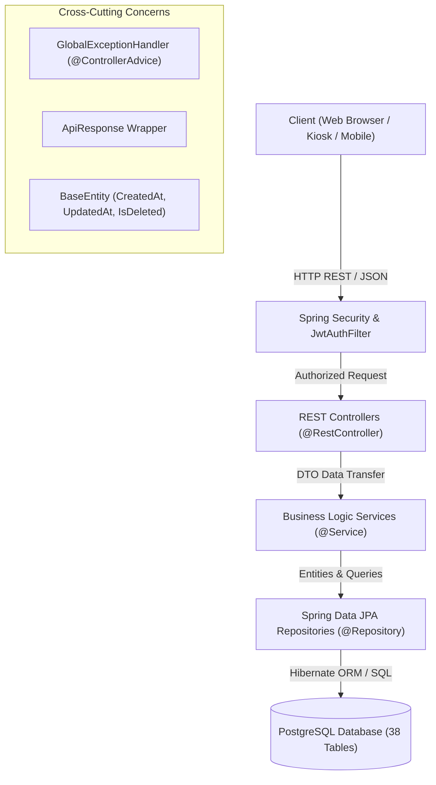
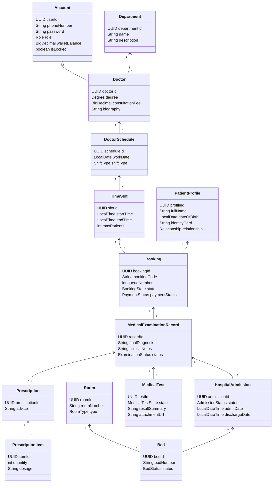
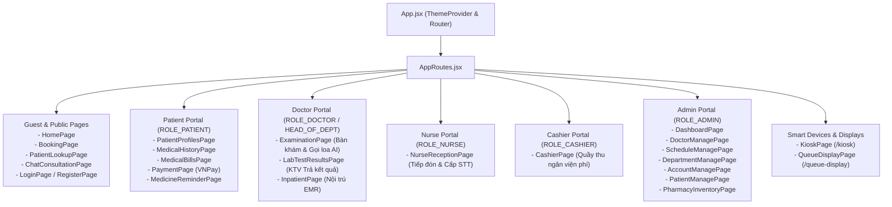

# 🏛️ ARCHITECTURE.MD - KIẾN TRÚC & CẤU TRÚC FILE DỰ ÁN
**Hệ Thống Quản Lý Bệnh Viện Thông Minh - YOUMED TNT HOSPITAL**

---

## 📁 1. CẤU TRÚC TỔNG THỂ THƯ MỤC DỰ ÁN (PROJECT DIRECTORY TREE)

```
hospital-api (1)/
├── .github/                      # CI/CD Workflows & GitHub Configurations
├── backups/                      # Bản sao lưu cấu hình & mã nguồn
├── docker-compose.yml            # Khởi chạy PostgreSQL, pgAdmin & Container
├── memory.md                     # [CORE] Ngữ cảnh hệ thống & Quy tắc làm việc
├── architecture.md               # [CORE] Cấu trúc file & Thiết kế kiến trúc
├── master-plan.md                # [CORE] Kế hoạch tổng quan toàn hệ thống (Roadmap)
├── plan.md                       # [CORE] Bảng theo dõi trạng thái công việc (Task Tracker)
├── test-plans/                   # [TEST] Thư mục lưu vết Testing Plan các module
│   ├── README.md                 # Hướng dẫn kiểm thử & đối soát hồi quy
│   ├── module_01_doctor_schedule.md
│   ├── module_02_doctor_queue_lab.md
│   ├── module_03_inpatient_emr.md
│   ├── module_04_kiosk_reception.md
│   ├── module_05_ai_triage.md
│   ├── module_06_pharmacy_inventory.md
│   └── module_07_payment_cashier.md
│
├── hospital-api/                 # BACKEND: Spring Boot 3.4.3 & Java 21
│   ├── pom.xml                   # Cấu hình Maven Dependencies
│   ├── Dockerfile                # Docker Image Build
│   └── src/main/java/com/hospital/api/
│       ├── HospitalApiApplication.java # Entry point
│       ├── common/               # Response chuẩn ApiResponse<T>, BaseEntity
│       ├── config/               # SecurityConfig, CorsConfig, WebMvcConfig
│       ├── constant/             # Enums: Role, BookingState, MedicalTestState, ShiftType
│       ├── controller/           # 17 REST API Controllers
│       ├── dto/                  # Request / Response DTOs
│       ├── entity/               # 38 JPA Entities (PostgreSQL)
│       ├── exception/            # GlobalExceptionHandler, CustomExceptions
│       ├── repository/           # Spring Data JPA Repositories
│       ├── security/             # JwtTokenProvider, JwtAuthFilter, UserDetailsServiceImpl
│       └── service/              # Service Interfaces & Implementations (`service/impl`)
│
├── hospital-ui/                  # FRONTEND: React 18, Vite 6, Material UI (MUI v6)
│   ├── package.json              # NPM Dependencies & Scripts
│   ├── vite.config.js            # Vite build configuration & proxy
│   ├── index.html                # HTML Template & Google Fonts (Inter/Roboto)
│   └── src/
│       ├── main.jsx              # Entry point ReactDOM.createRoot
│       ├── App.jsx               # ThemeProvider, CssBaseline, ToastContainer, AppRoutes
│       ├── components/           # UI Components dùng chung (Header, Footer, Dialogs, Cards)
│       ├── context/              # AuthContext, NotificationContext, Socket/QueueContext
│       ├── layouts/              # MainLayout, AdminLayout, DoctorLayout, BlankLayout
│       ├── pages/                # Các trang theo phân hệ người dùng
│       │   ├── auth/             # LoginPage, RegisterPage
│       │   ├── patient/          # HomePage, PatientProfilesPage, MedicalHistoryPage,
│       │   │                     # MedicalBillsPage, PaymentPage, MedicineReminderPage, PatientLookupPage
│       │   ├── customer/         # BookingPage (Quy trình đặt lịch 4 bước)
│       │   ├── Doctor/           # ExaminationPage, InpatientPage, LabTestResultsPage,
│       │   │                     # AssignTestsModal, PrescriptionModal, PrintModals
│       │   ├── nurse/            # NurseReceptionPage (Tiếp đón & phân luồng quầy)
│       │   ├── cashier/          # CashierPage (Quầy thu ngân & xuất phiếu thu)
│       │   ├── admin/            # DashboardPage, DoctorManagePage, ScheduleManagePage,
│       │   │                     # DepartmentManagePage, AccountManagePage, PatientManagePage,
│       │   │                     # MedicineManagePage, PharmacyInventoryPage, MedicalServiceManagePage,
│       │   │                     # TransactionManagePage, EhrAndGatewayPage
│       │   ├── KioskPage.jsx     # Cây Kiosk sảnh tự phục vụ (chọn khoa, đối tượng, in STT)
│       │   ├── QueueDisplayPage.jsx # Màn hình LED TV gọi số phòng khám có chuông & phát âm
│       │   ├── ChatConsultationPage.jsx # AI Trợ lý Y tế Triage 24/7
│       │   └── error/            # NotFoundPage, UnauthorizedPage
│       ├── routes/               # AppRoutes.jsx, ProtectedRoute.jsx
│       ├── services/             # Axios API Client (authService, doctorService, bookingService...)
│       ├── theme/                # theme.js (Palette, Typography, Components Override)
│       └── utils/                # formatters (tiền tệ VNĐ, ngày giờ), soundUtils (chuông)
│
└── test_*.js & seed_*.js         # Kịch bản kiểm thử tự động Node.js & Dữ liệu mẫu
    ├── test_master_system_audit.js   # Audit toàn diện toàn bộ 8 phân hệ
    ├── test_module1.js               # Kiểm thử Bác sĩ & Lịch trực
    ├── test_module2.js               # Kiểm thử Hàng đợi Bác sĩ & Lab Tests
    ├── test_module3.js               # Kiểm thử Điều trị Nội trú & EMR
    ├── test_module4_kiosk.js         # Kiểm thử Kiosk & Tiếp đón điều dưỡng
    ├── test_module5_ai_chat.js       # Kiểm thử AI Triage & Đặt khám 1-Click
    ├── test_vnpay_payment.js         # Kiểm thử Cổng VNPay & Ví viện phí
    └── seed_full_master_dataset.js   # Khởi tạo dữ liệu mẫu toàn diện
```

---

## ⚙️ 2. BACKEND LAYERED ARCHITECTURE (`hospital-api`)

Kiến trúc Backend tuân theo mô hình **Phân lớp Chuẩn Doanh Nghiệp (Enterprise Layered Architecture)**:



### 2.1 Danh Sách 17 REST API Controllers:

| STT | Controller | Prefix URL | Mục đích & Nghiệp vụ |
| :---: | :--- | :--- | :--- |
| **1** | [`AuthController`](file:///c:/Users/ASUS/Downloads/hospital-api%20%281%29/hospital-api/src/main/java/com/hospital/api/controller/AuthController.java) | `/api/auth` | Đăng nhập SĐT, đăng ký bệnh nhân, xác thực JWT token |
| **2** | [`DepartmentController`](file:///c:/Users/ASUS/Downloads/hospital-api%20%281%29/hospital-api/src/main/java/com/hospital/api/controller/DepartmentController.java) | `/api/departments` | CRUD chuyên khoa, gán bác sĩ, chỉ định trưởng khoa |
| **3** | [`DoctorAdminController`](file:///c:/Users/ASUS/Downloads/hospital-api%20%281%29/hospital-api/src/main/java/com/hospital/api/controller/DoctorAdminController.java) | `/api/admin/doctors` | Quản lý danh sách bác sĩ, học vị, chuyên môn, giá khám |
| **4** | [`ScheduleController`](file:///c:/Users/ASUS/Downloads/hospital-api%20%281%29/hospital-api/src/main/java/com/hospital/api/controller/ScheduleController.java) | `/api/schedules` | Phân lịch trực theo ca/buổi (Sáng/Chiều/Tối), sinh TimeSlots |
| **5** | [`BookingController`](file:///c:/Users/ASUS/Downloads/hospital-api%20%281%29/hospital-api/src/main/java/com/hospital/api/controller/BookingController.java) | `/api/bookings` | Đặt lịch khám 4 bước, cấp STT, tra cứu phiếu khám |
| **6** | [`ClinicalExaminationController`](file:///c:/Users/ASUS/Downloads/hospital-api%20%281%29/hospital-api/src/main/java/com/hospital/api/controller/ClinicalExaminationController.java) | `/api/clinical` | Hàng đợi gọi số bác sĩ, phiếu khám, kê đơn thuốc, chỉ định CLS |
| **7** | [`InpatientController`](file:///c:/Users/ASUS/Downloads/hospital-api%20%281%29/hospital-api/src/main/java/com/hospital/api/controller/InpatientController.java) | `/api/inpatient` | Quản lý bệnh nhân nội trú, nhập viện, y lệnh, chăm sóc, xuất viện |
| **8** | [`PharmacyInventoryController`](file:///c:/Users/ASUS/Downloads/hospital-api%20%281%29/hospital-api/src/main/java/com/hospital/api/controller/PharmacyInventoryController.java) | `/api/pharmacy` | Quản lý kho dược đa kho, lô thuốc, hạn dùng, cấp phát toa thuốc |
| **9** | [`PaymentController`](file:///c:/Users/ASUS/Downloads/hospital-api%20%281%29/hospital-api/src/main/java/com/hospital/api/controller/PaymentController.java) | `/api/payment` | Tạo URL thanh toán VNPay-QR, xử lý IPN callback, nạp ví viện phí |
| **10** | [`PatientProfileController`](file:///c:/Users/ASUS/Downloads/hospital-api%20%281%29/hospital-api/src/main/java/com/hospital/api/controller/PatientProfileController.java) | `/api/profiles` | CRUD hồ sơ bệnh nhân đa đối tượng (bản thân, con, bố mẹ) |
| **11** | [`AccountAdminController`](file:///c:/Users/ASUS/Downloads/hospital-api%20%281%29/hospital-api/src/main/java/com/hospital/api/controller/AccountAdminController.java) | `/api/admin/accounts` | Khóa/mở khóa tài khoản, phân quyền RBAC, đổi mật khẩu khẩn cấp |
| **12** | [`AiChatController`](file:///c:/Users/ASUS/Downloads/hospital-api%20%281%29/hospital-api/src/main/java/com/hospital/api/controller/AiChatController.java) | `/api/ai` | AI Trợ lý Y tế Triage 24/7, phát hiện cấp cứu, gợi ý đặt khám |
| **13** | [`ChatController`](file:///c:/Users/ASUS/Downloads/hospital-api%20%281%29/hospital-api/src/main/java/com/hospital/api/controller/ChatController.java) | `/api/chat` | Lưu trữ và truy vấn tin nhắn hội thoại tư vấn y tế |
| **14** | [`EhrAdminController`](file:///c:/Users/ASUS/Downloads/hospital-api%20%281%29/hospital-api/src/main/java/com/hospital/api/controller/EhrAdminController.java) | `/api/admin/ehr` | Truy xuất hồ sơ EMR toàn diện và quản lý xuất file bệnh án |
| **15** | [`ClinicalGatewayController`](file:///c:/Users/ASUS/Downloads/hospital-api%20%281%29/hospital-api/src/main/java/com/hospital/api/controller/ClinicalGatewayController.java) | `/api/gateway` | Cổng tích hợp liên thông dữ liệu y tế ngoại vi |
| **16** | [`MedicalConceptController`](file:///c:/Users/ASUS/Downloads/hospital-api%20%281%29/hospital-api/src/main/java/com/hospital/api/controller/MedicalConceptController.java) | `/api/concepts` | Thuật ngữ y khoa ICD-10, khái niệm chẩn đoán chuẩn hóa |
| **17** | [`UtilityController`](file:///c:/Users/ASUS/Downloads/hospital-api%20%281%29/hospital-api/src/main/java/com/hospital/api/controller/UtilityController.java) | `/api/utilities` | Thống kê dashboard, tổng hợp doanh thu, biểu đồ chuyên khoa |

---

## 🗄️ 3. MÔ HÌNH DỮ LIỆU ENTITIES (POSTGRESQL ORM)

Hệ thống có **38 JPA Entities** được tổ chức thành 7 cụm nghiệp vụ chặt chẽ:



---

## 💻 4. KIẾN TRÚC FRONTEND (`hospital-ui`)

Giao diện người dùng phân chia theo **Vai trò người dùng (Role-based Portal Architecture)**:



---

## 🔒 5. BẢO MẬT & LUỒNG XÁC THỰC (SECURITY & JWT WORKFLOW)

1. **Xác thực:** Bệnh nhân/Nhân viên đăng nhập qua `/api/auth/login` với Số điện thoại và Mật khẩu (đã mã hóa BCrypt).
2. **Token:** Server trả về JWT Bearer token có thời hạn và payload chứa: `userId`, `phoneNumber`, `role`, `fullName`.
3. **Frontend Interceptor:** `axios` đính kèm header `Authorization: Bearer <token>` trong mọi request đến API được bảo vệ.
4. **Backend Filter:** `JwtAuthFilter` giải mã token, kiểm tra hạn dùng, nạp `UsernamePasswordAuthenticationToken` vào `SecurityContextHolder`.
5. **RBAC:** `@PreAuthorize("hasAnyRole('ADMIN', 'DOCTOR')")` bảo vệ tầng Controller và Service.
