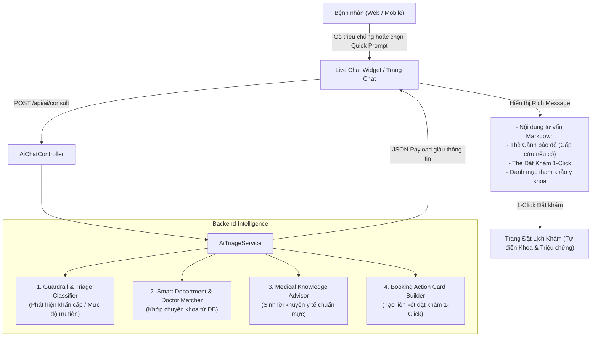

# Kế Hoạch Triển Khai: AI Trợ Lý Y Tế 24/7 & Tự Động Gợi Ý Đặt Khám Chuyên Khoa (Smart AI Triage & Booking)

Tích hợp hệ thống **AI Healthcare Assistant (Trợ lý Y tế Thông minh 24/7)** dựa trên nghiên cứu từ `Chatbot-Health`, kết hợp trực tiếp với cơ sở dữ liệu chuyên khoa, bác sĩ và lịch khám thực tế của bệnh viện.

---

## 1. Mục Tiêu & Kiến Trúc Giải Pháp

---

## 2. Chi Tiết Các Thay Đổi Cần Thực Hiện

### 2.1 Backend (Spring Boot 3.4 & Java 21)

#### [NEW] [AiConsultationRequest.java](file:///c:/Users/ASUS/Downloads/hospital-api%20%281%29/hospital-api/src/main/java/com/hospital/api/dto/request/AiConsultationRequest.java)
- Chứa `message` (câu hỏi/triệu chứng), `conversationHistory` (ngữ cảnh hội thoại trước đó), `patientAge`, `gender` (nếu có).

#### [NEW] [AiConsultationResponse.java](file:///c:/Users/ASUS/Downloads/hospital-api%20%281%29/hospital-api/src/main/java/com/hospital/api/dto/response/AiConsultationResponse.java)
- Cấu trúc trả về gồm:
  - `replyText`: Lời giải đáp y khoa, nguyên nhân, hướng dẫn chăm sóc/sơ cứu tại nhà.
  - `triageLevel`: `EMERGENCY` 🚨, `URGENT` ⚠️, `ROUTINE` ℹ️, `GENERAL_INFO`.
  - `emergencyAlert`: Nội dung cảnh báo khẩn cấp + hotline.
  - `suggestedDepartment`: Thông tin chuyên khoa phù hợp nhất (`departmentId`, `name`, `description`, `icon`).
  - `suggestedDoctors`: Danh sách bác sĩ thuộc chuyên khoa.
  - `bookingAction`: Thẻ hành động đặt khám trực tiếp (`departmentId`, `departmentName`, `symptoms`, `actionUrl`).
  - `medicalCitations`: Danh mục bài viết/nguồn tham khảo y tế chính thống.

#### [NEW] [AiTriageService.java](file:///c:/Users/ASUS/Downloads/hospital-api%20%281%29/hospital-api/src/main/java/com/hospital/api/service/AiTriageService.java) & [AiTriageServiceImpl.java](file:///c:/Users/ASUS/Downloads/hospital-api%20%281%29/hospital-api/src/main/java/com/hospital/api/service/impl/AiTriageServiceImpl.java)
- Bộ quy tắc y khoa và phân tích ngữ nghĩa tiếng Việt chuyên sâu cho các nhóm bệnh lý:
  - **Tim mạch & Lồng ngực**: Đau tức ngực, khó thở, hồi hộp, tim đập nhanh -> *Khoa Tim Mạch / Cấp cứu*.
  - **Thần kinh & Đầu**: Đau đầu dữ dội, chóng mặt, tê bì nửa người -> *Khoa Thần Kinh*.
  - **Tiêu hóa & Gan mật**: Đau bụng quặn, ợ chua, nôn, xuất huyết tiêu hóa -> *Khoa Tiêu Hóa*.
  - **Cơ xương khớp**: Đau khớp gối, thoái hóa cột sống, sưng đau cổ chân -> *Khoa Cơ Xương Khớp / Ngoại Tổng Hợp*.
  - **Hô hấp & Nhi khoa**: Sốt cao, ho có đờm, thở rít ở trẻ em -> *Khoa Nhi / Khoa Hô Hấp*.
  - **Tai Mũi Họng, Mắt, Da Liễu, Nam học / Phụ sản** tương ứng.
- Động khớp với danh sách `Department` thực tế từ Database.

#### [NEW] [AiChatController.java](file:///c:/Users/ASUS/Downloads/hospital-api%20%281%29/hospital-api/src/main/java/com/hospital/api/controller/AiChatController.java)
- Endpoint: `POST /api/ai/consult` (Phục vụ 24/7 công khai không bắt buộc token).
- Endpoint: `GET /api/ai/prompts` (Danh sách câu hỏi gợi ý nhanh).

#### [MODIFY] [SecurityConfig.java](file:///c:/Users/ASUS/Downloads/hospital-api%20%281%29/hospital-api/src/main/java/com/hospital/api/config/SecurityConfig.java)
- Cho phép `permitAll()` cho `/api/ai/**`.

---

### 2.2 Frontend (React 18 & Material UI)

#### [MODIFY] [LiveChatWidget.jsx](file:///c:/Users/ASUS/Downloads/hospital-api%20%281%29/hospital-ui/src/components/chat/LiveChatWidget.jsx)
- Thêm Tab chuyển đổi linh hoạt:
  - 🤖 **AI Y Tế 24/7**: Mặc định mở ra ngay cả khi chưa đăng nhập, tư vấn tức thì trong 1 giây.
  - 👨‍⚕️ **Bác sĩ Trực Tuyến**: Chat thực tế với Bác sĩ (khi đã đăng nhập).
- Hiển thị **Rich Action Cards**:
  - Khối Cảnh Báo Khẩn Cấp Đỏ (nếu phát hiện triệu chứng nguy hiểm) kèm nút gọi Hotline 1900 8888.
  - Khối **Gợi Ý Khám & Đặt Lịch 1-Click**: Nút bấm đẹp mắt chuyển ngay sang `BookingPage` kèm dữ liệu điền sẵn.
  - Khối Tài liệu tham khảo y khoa.
- Quick Prompt Pills (Bấm nhanh các câu hỏi phổ biến: *"Đau đầu sốt cao", "Đau ngực khó thở", "Đau khớp gối", "Trẻ bị ho sốt"*).

#### [MODIFY] [ChatConsultationPage.jsx](file:///c:/Users/ASUS/Downloads/hospital-api%20%281%29/hospital-ui/src/pages/ChatConsultationPage.jsx)
- Thêm đối tác trò chuyện cố định: **🤖 Trợ Lý Y Tế AI 24/7 (TNT Smart AI)** ở đầu danh bạ.

#### [MODIFY] [BookingPage.jsx](file:///c:/Users/ASUS/Downloads/hospital-api%20%281%29/hospital-ui/src/pages/customer/BookingPage.jsx)
- Hỗ trợ nhận query params `?departmentId=...&symptoms=...` từ chatbot để tự động kích hoạt chọn chuyên khoa và điền triệu chứng.

---

## 3. Kế Hoạch Kiểm Thử (Verification Plan)

### Automated Tests:
- Tạo `test_module5_ai_chat.js`:
  1. `GET /api/ai/prompts` -> Lấy danh sách câu hỏi mẫu thành công.
  2. `POST /api/ai/consult` với triệu chứng tim mạch -> Kiểm tra phân loại, gợi ý đúng Khoa Tim Mạch và thẻ đặt lịch.
  3. `POST /api/ai/consult` với triệu chứng cấp cứu (đột quỵ, ngất xỉu) -> Kiểm tra cờ `EMERGENCY` và cảnh báo đỏ.
  4. `POST /api/ai/consult` với câu hỏi thông thường -> Trả về lời giải đáp y khoa và tài liệu tham khảo.
  5. Chạy toàn bộ 39 testcases qua các Module 1, 2, 3, 4, 5 và E2E.

### Manual Verification:
- Mở LiveChatWidget trên trình duyệt, hỏi triệu chứng và bấm nút "Đặt lịch khám khoa..." để kiểm tra luồng 1-Click Booking.
