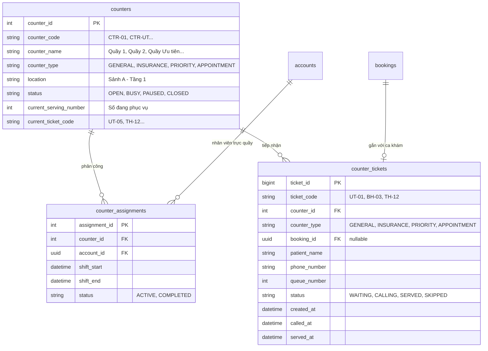

# 📋 KẾ HOẠCH TRIỂN KHAI: QUẢN LÝ QUẦY TIẾP ĐÓN (COUNTER) & TỐI ƯU HÓA LUỒNG BỐC SỐ KIOSK

> **Mã công việc:** TASK-15  
> **Người lập:** Senior Fullstack & Medical Systems Engineer  
> **Nguồn cảm hứng nghiệp vụ:**  
> 1. `revita-be` (`src/counter/`, `src/booth-queue/`, `prisma/schema.prisma: model Counter & CounterAssignment`) - Mô hình Quầy tiếp đón phân quyền và xoay vòng quầy.  
> 2. `revita-be` (`src/booth-queue/priority-calculator.service.ts`) - Cơ chế phân loại luồng ưu tiên tự động (Priority Triage).  
> **Trạng thái:** ⏳ **CHỜ PHÊ DUYỆT (WAITING FOR APPROVAL)**

---

## 🎯 1. BỐI CẢNH VÀ MỤC TIÊU NGHIỆP VỤ

### 1.1. Thực trạng tại các bệnh viện / phòng khám đa khoa
Hiện tại, tại sảnh bệnh viện:
- Khi bệnh nhân đến bốc số tại cây Kiosk, hệ thống chỉ cấp số thứ tự vào thẳng phòng khám bác sĩ.
- Trong thực tế quy trình y tế bệnh viện:
  1. Bệnh nhân cần qua **Quầy thủ tục tiếp đón (Reception Desk / Counter)** tại sảnh để: kiểm tra thẻ BHYT, đối chiếu CCCD, cập nhật thông tin hành chính, thu tiền khám ban đầu hoặc xác nhận đăng ký trước khi vào buồng khám của Bác sĩ.
  2. Bệnh nhân có nhiều nhu cầu khác nhau:
     - **Bệnh nhân Ưu tiên:** Người cao tuổi ($\ge 65$ tuổi), Trẻ em ($< 6$ tuổi), Phụ nữ có thai, Người khuyết tật ➔ Cần được định tuyến tới **Quầy Tiếp đón Ưu tiên** để được phục vụ ngay.
     - **Bệnh nhân BHYT:** Cần quét thẻ BHYT, kiểm tra thông tuyến ➔ Cần định tuyến tới **Quầy Tiếp đón BHYT**.
     - **Bệnh nhân Đặt hẹn trước (Online Booking):** Đã có mã đặt khám ➔ Cần luồng Check-in nhanh (Fast-track) tại **Quầy Tiếp đón Đặt hẹn**.
     - **Bệnh nhân Khám thường / Vãng lai:** Cần phân bổ đều theo cơ chế **Cân bằng tải ít chờ nhất (Least-loaded / Round-robin)** vào các Quầy Tiếp đón Thường đang mở.

### 1.2. Mục tiêu kỹ thuật của TASK-15
1. **Module Quản lý Quầy Tiếp đón (`Counter Management`):**
   - Thiết lập danh mục các quầy tại sảnh (Quầy 1, Quầy 2, Quầy Ưu tiên, Quầy BHYT, Quầy Fast-track).
   - Cho phép Điều dưỡng / Lễ tân đăng nhập mở quầy làm việc (`OPEN`), tạm dừng (`PAUSED`), hoặc đóng quầy (`CLOSED`).
   - Giao diện thao tác tại quầy: Gọi số tiếp theo (`Call Next`), Bỏ qua ca vắng (`Skip`), Hoàn tất thủ tục & phân vào buồng khám Bác sĩ (`Complete & Dispatch`).
   - Tích hợp chuông Ding-dong và phát loa đọc số quầy: *"Mời số thứ tự [STT] đến Quầy [Tên Quầy]"*.
2. **Tối ưu hóa luồng bốc số Kiosk (`Smart Kiosk Dispatching`):**
   - Nâng cấp giao diện Kiosk thân thiện, màn hình cảm ứng khổ lớn:
     - **Chế độ 1 - Check-in Lịch hẹn trước:** Nhập mã `BK-...` hoặc SĐT ➔ Tự động in phiếu ưu tiên và chỉ dẫn đến Quầy tiếp nhận đặt hẹn.
     - **Chế độ 2 - Lấy số vãng lai thông minh:**
       - Chọn Chuyên khoa khám.
       - Tự động nhận diện diện ưu tiên qua năm sinh / tick chọn đối tượng.
       - Tự động chọn BHYT hoặc Dịch vụ.
       - **Thuật toán Định tuyến Quầy Thông minh:** Tự động tính toán quầy đang mở phù hợp và có số lượng chờ ít nhất.
   - Phiếu in nhiệt Kiosk đầy đủ thông tin:
     - Số thứ tự tại quầy (ví dụ: `UT-01`, `BH-03`, `TH-12`).
     - Tên quầy và vị trí chỉ dẫn (ví dụ: `Quầy 3 - Tầng 1 (Ưu tiên)`).
     - Số lượng bệnh nhân đang đợi trước mặt.
     - Mã QR tra cứu tiến trình hàng đợi trên điện thoại.
3. **Màn hình LED TV Hàng đợi Quầy Tiếp đón (`Counter Queue Display`):**
   - Tích hợp thêm tab/khu vực hiển thị số thứ tự đang gọi tại các Quầy tiếp đón sảnh, giúp bệnh nhân ngồi tại ghế chờ dễ dàng quan sát.

---

## 🏗️ 2. THIẾT KẾ KIẾN TRÚC & THỰC THỂ DỮ LIỆU (DATABASE SCHEMA)

> [!NOTE]
> **Nguyên tắc an toàn dữ liệu:** Áp dụng mô hình thêm mới bảng độc lập, **TUYỆT ĐỐI KHÔNG SỬA ĐỔI / KHÔNG XÓA BẤT KỲ CỘT NÀO** của các bảng hiện có (`bookings`, `rooms`, `doctors`...).

### 2.1. Các Enums mới
1. **`CounterType`**:
   - `GENERAL`: Quầy tiếp đón bệnh nhân khám thường.
   - `INSURANCE`: Quầy tiếp đón bệnh nhân BHYT.
   - `PRIORITY`: Quầy tiếp đón đối tượng chính sách / ưu tiên (Người già $\ge 65$, Trẻ em $< 6$, Thai phụ).
   - `APPOINTMENT`: Quầy tiếp nhận bệnh nhân đã đặt hẹn online (Fast-track).
2. **`CounterStatus`**:
   - `OPEN`: Đang mở phục vụ.
   - `BUSY`: Đang phục vụ bệnh nhân.
   - `PAUSED`: Tạm dừng nghỉ ca.
   - `CLOSED`: Đóng quầy.
3. **`CounterTicketStatus`**:
   - `WAITING`: Đang chờ gọi.
   - `CALLING`: Đang gọi vào quầy.
   - `SERVED`: Đã tiếp nhận xong thủ tục.
   - `SKIPPED`: Vắng mặt / Bỏ qua.

---

## 🛠️ 3. CÁC TẬP TIN DỰ KIẾN THAY ĐỔI & TẠO MỚI

### 3.1. Backend Java (Spring Boot)
1. **Entities & Enums (Tạo mới):**
   - `Counter.java`: Thực thể quầy tiếp đón.
   - `CounterAssignment.java`: Lịch sử phân công điều dưỡng trực quầy.
   - `CounterTicket.java`: Phiếu bốc số tại quầy.
   - `CounterType.java`, `CounterStatus.java`, `CounterTicketStatus.java`.
2. **Repositories (Tạo mới):**
   - `CounterRepository.java`: Truy vấn quầy theo trạng thái, loại quầy.
   - `CounterAssignmentRepository.java`: Quản lý phiên trực của điều dưỡng.
   - `CounterTicketRepository.java`: Đếm số người chờ, lấy danh sách chờ, lấy số tiếp theo.
3. **DTOs (Tạo mới):**
   - `CounterResponse.java`, `CounterTicketResponse.java`, `KioskDispatchResponse.java`.
   - `CounterActionRequest.java` (mở quầy, gọi số, hoàn tất ca).
4. **Services & Controllers (Tạo mới & Mở rộng):**
   - `CounterService.java` & `CounterServiceImpl.java`: Logic phân bổ quầy, gọi số, cân bằng tải.
   - `CounterController.java`:
     - `GET /api/counters`: Danh sách quầy và tình trạng tải hiện tại (phục vụ Kiosk và màn hình sảnh).
     - `POST /api/counters/{id}/check-in`: Điều dưỡng mở quầy làm việc.
     - `POST /api/counters/{id}/call-next`: Gọi số tiếp theo vào quầy.
     - `POST /api/counters/{id}/complete`: Hoàn tất tiếp nhận tại quầy.
     - `POST /api/counters/{id}/skip`: Bỏ qua lượt vắng mặt.
     - `POST /api/counters/kiosk/dispatch`: Endpoint bốc số thông minh từ Kiosk.
5. **Cấu hình Bảo mật (`SecurityConfig.java`):**
   - Mở quyền công khai `permitAll()` cho `GET /api/counters`, `POST /api/counters/kiosk/dispatch` (phục vụ Kiosk).
   - Phân quyền `hasAnyRole('NURSE', 'ADMIN')` cho các API vận hành quầy.

### 3.2. Frontend React (`hospital-ui`)
1. **Giao diện Cây Kiosk sảnh ([`KioskPage.jsx`](file:///c:/Users/ASUS/Downloads/hospital-api%20%281%29/hospital-ui/src/pages/KioskPage.jsx)):**
   - Cải tiến giao diện màn hình cảm ứng:
     - Bổ sung hiển thị thông tin quầy tiếp đón trực quan trên phiếu nhiệt: Tên quầy, vị trí, số người chờ.
     - Gợi ý phân luồng tự động (Ưu tiên, BHYT, Thường, Đặt trước).
2. **Giao diện Quản lý Quầy Điều dưỡng (`CounterReceptionPage.jsx` hoặc tích hợp vào [`NurseReceptionPage.jsx`](file:///c:/Users/ASUS/Downloads/hospital-api%20%281%29/hospital-ui/src/pages/nurse/NurseReceptionPage.jsx)):**
   - Điều dưỡng chọn Quầy mình phụ trách (ví dụ Quầy 1).
   - Nút to rõ: "GỌI SỐ TIẾP THEO", "TIẾP NHẬN XONG", "BỎ QUA".
   - Tích hợp gọi loa tự động phát giọng đọc AI tiếng Việt: *"Mời số thứ tự UT-01 đến Quầy 3 - Ưu tiên"*.
3. **Màn hình LED TV sảnh ([`QueueDisplayPage.jsx`](file:///c:/Users/ASUS/Downloads/hospital-api%20%281%29/hospital-ui/src/layouts/AdminLayout.jsx)):**
   - Thêm bảng hiển thị trạng thái các Quầy tiếp đón (Số đang gọi, Tên quầy, Trạng thái) song song với phòng khám bác sĩ.

---

## 🧪 4. KỊCH BẢN KIỂM THỬ TỰ ĐỘNG (AUTOMATED TEST PLAN)

Tạo file kịch bản kiểm thử tự động độc lập `test_counter_kiosk_workflow.js`:
1. **Ca 1 (Khởi tạo Quầy):** Đăng nhập Admin/Nurse, kiểm tra danh sách 4 quầy (`CTR-01` Thường, `CTR-02` BHYT, `CTR-03` Ưu tiên, `CTR-04` Đặt hẹn).
2. **Ca 2 (Điều dưỡng mở quầy):** Nurse đăng nhập, gọi `POST /api/counters/1/check-in` ➔ Quầy chuyển sang `OPEN`.
3. **Ca 3 (Kiosk bốc số Ưu tiên):** Gửi request Kiosk với bệnh nhân 75 tuổi ➔ Hệ thống cấp số `UT-01` và tự động định tuyến đến `Quầy 3 - Tiếp đón Ưu tiên`.
4. **Ca 4 (Kiosk bốc số BHYT):** Gửi request Kiosk có BHYT ➔ Hệ thống cấp số `BH-01` và định tuyến đến `Quầy 2 - BHYT`.
5. **Ca 5 (Kiosk bốc số Thường & Cân bằng tải):** Gửi nhiều request thường ➔ Hệ thống phân bổ đều vào các quầy thường đang mở.
6. **Ca 6 (Điều dưỡng gọi số):** Quầy gọi `POST /api/counters/{id}/call-next` ➔ Phiếu chuyển sang `CALLING`, cập nhật `currentServingNumber`.
7. **Ca 7 (Hoàn tất tiếp đón):** Gọi `POST /api/counters/{id}/complete` ➔ Phiếu chuyển `SERVED`, chuyển tiếp bệnh nhân vào hàng đợi bác sĩ.
8. **Ca 8 (Kiểm thử hồi quy):** Chạy lại toàn bộ `test_security_hardening.js` (16/16 PASS) và `test_cashier_workflow.js` (8/8 PASS) để đảm bảo 100% không phát sinh lỗi phụ.

---

## 🛑 5. ĐIỂM DỪNG CHỜ PHÊ DUYỆT (STOP & WAIT)

Theo quy định bắt buộc của dự án:
- Kế hoạch trên đã được lập chi tiết và lưu tại [`implementation_plan_counter_and_kiosk_routing.md`](file:///c:/Users/ASUS/Downloads/hospital-api%20%281%29/implementation_plan_counter_and_kiosk_routing.md).
- **MÃ NGUỒN SẼ KHÔNG ĐƯỢC PHÉP CHỈNH SỬA** cho đến khi bạn xem xét và đưa ra quyết định phê duyệt.
