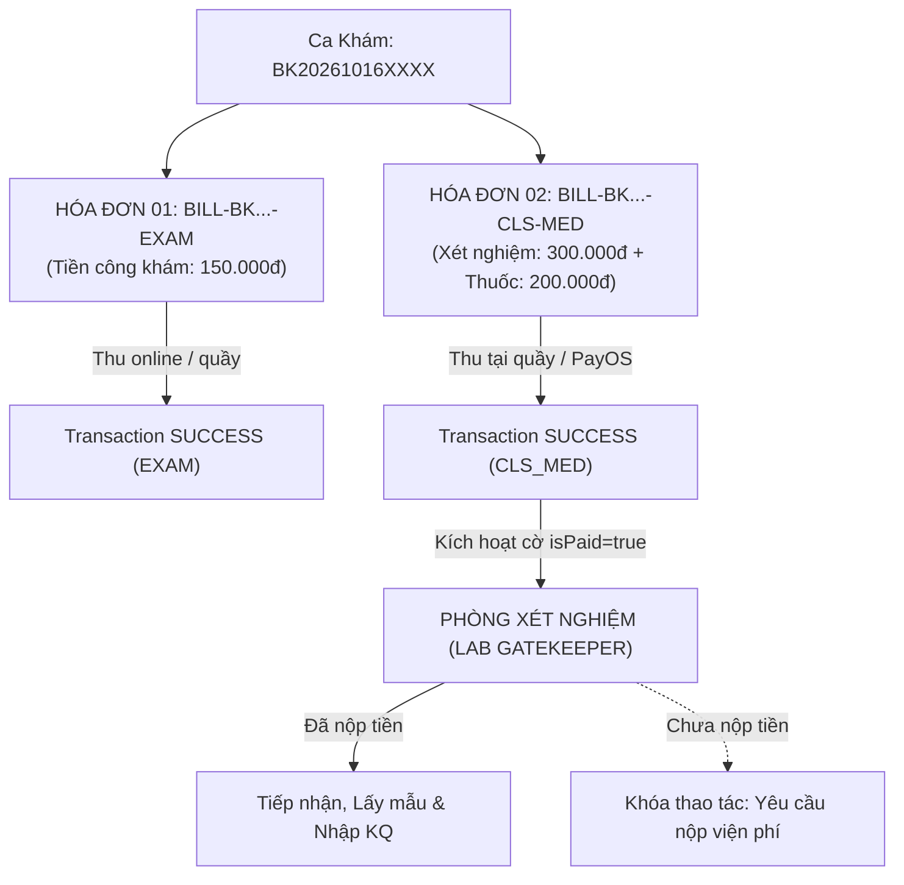

# 📋 KẾ HOẠCH TRIỂN KHAI (IMPLEMENTATION PLAN)
## Chuẩn Hóa Mô Hình Đa Hóa Đơn, Chốt Chặn Phòng Xét Nghiệm & Tích Hợp Chi Tiết PayOS

> **Ngày lập:** 16/10/2026  
> **Tham khảo kiến trúc:** `revita-be` (`src/invoice/`, `src/booth-queue/`, `@payos/node`)  
> **Mục tiêu:** 
> 1. Xóa bỏ triệt để lỗi kiểm tra trùng `alreadyPaid` gây thất thoát viện phí phát sinh.
> 2. Chuẩn hóa mô hình **Đa hóa đơn (Multi-Invoice per Booking)**: Hóa đơn 01 (Khám ban đầu) & Hóa đơn 02 (Cận lâm sàng + Thuốc). Cho phép thu từng hóa đơn hoặc thu gộp.
> 3. Thiết lập **Chốt chặn phòng Cận lâm sàng (Lab Gatekeeper)**: Phòng xét nghiệm chỉ lấy mẫu / nhập kết quả khi viện phí đã nộp (`isPaid = true`).
> 4. **Đẩy chi tiết danh mục (`items`) sang PayOS Open Banking**: Khách hàng quét mã QR hoặc mở PayOS Checkout sẽ thấy rõ từng khoản viện phí.

---

### 1. Phân Tích Hiện Trạng & Rủi Ro Thất Thoát Viện Phí

#### A. Lỗ hổng thất thoát viện phí phát sinh (`alreadyPaid` Bug)
* **Hiện trạng tại [CashierServiceImpl.java](file:///c:/Users/ASUS/Downloads/hospital-api%20%281%29/hospital-api/src/main/java/com/hospital/api/service/impl/CashierServiceImpl.java#L70-L141)**:
  ```java
  boolean alreadyPaid = transactionRepository.existsByDescriptionContainingAndStatus(bookingCode, "SUCCESS");
  if (alreadyPaid) continue; // hoặc throw exception CONFLICT
  ```
* **Hậu quả**: Khi bệnh nhân trả 150.000đ tiền khám online/kiosk trước, hệ thống đã lưu 1 transaction `SUCCESS` chứa `bookingCode`. Khi bác sĩ chỉ định thêm 300.000đ tiền máu + 200.000đ tiền thuốc, quầy thu ngân bị chặn hoàn toàn, **bỏ qua khoản viện phí phát sinh 500.000đ**!

#### B. Thất thoát tại phòng Cận lâm sàng (Thiếu Lab Gatekeeper)
* **Hiện trạng tại [ClinicalExaminationServiceImpl.java](file:///c:/Users/ASUS/Downloads/hospital-api%20%281%29/hospital-api/src/main/java/com/hospital/api/service/impl/ClinicalExaminationServiceImpl.java#L530-L570)**:
  Kỹ thuật viên phòng Lab thấy danh sách `WAITING` là có thể lấy mẫu bệnh phẩm và trả kết quả ngay, dù bệnh nhân chưa đóng 1 đồng viện phí xét nghiệm nào.

---

### 2. Thiết Kế Kiến Trúc Kỹ Thuật (Technical Design)



#### A. Mô hình Đa Hóa Đơn (`CashierPendingBillResponse`)
Mỗi ca khám sẽ được phân rã thành các hóa đơn con tùy theo giai đoạn phát sinh:
1. **Hóa đơn Tiền khám (`billId: "BILL-" + bookingCode + "-EXAM"`)**:
   - `billType`: `"EXAM"`
   - `totalAmount`: Tiền khám (`booking.getPrice()`).
   - Kiểm tra đã trả: Có transaction thành công chứa `"EXAM"` và `bookingCode`, hoặc tổng tiền đã trả khớp tiền khám.
2. **Hóa đơn Cận lâm sàng & Thuốc (`billId: "BILL-" + bookingCode + "-CLS-MED"`)**:
   - `billType`: `"TREATMENT"` (hoặc `"EXAM_AND_TESTS"`, `"PRESCRIPTION"` nếu chỉ có 1 trong 2).
   - `totalAmount`: Tổng tiền xét nghiệm + tiền thuốc.
   - Kiểm tra đã trả: Có transaction thành công cho đợt điều trị này hoặc tổng tiền thu $\ge$ tổng viện phí phát sinh.
3. **Hỗ trợ Thu gộp (`"BILL-" + bookingCode + "-ALL"`)**:
   - Nếu bệnh nhân chưa trả cả tiền khám lẫn tiền phát sinh, thu ngân có thể thu trọn gói 1 lần.

#### B. Chốt Chặn Phòng Xét Nghiệm (Lab Gatekeeper)
1. **`LabTestDetailResponse` & `MedicalTestResponse`**:
   - Bổ sung trường `boolean isPaid;`
   - Bổ sung trường `String paymentStatus;` (`"PAID"` | `"UNPAID"`)
2. **Logic Backend**:
   - Trong `ClinicalExaminationServiceImpl.java`:
     - Khi lấy danh sách xét nghiệm (`getLabTests`): Kiểm tra xem ca khám tương ứng đã thanh toán tiền xét nghiệm hay chưa.
     - Trong `collectSpecimen` & `updateTestResult`: Nếu `!isPaid` và không phải ca khám ưu tiên cấp cứu (`!booking.getIsPriority()`), quăng lỗi:
       `AppException("Chỉ định xét nghiệm này chưa được thanh toán viện phí. Vui lòng đóng tiền tại quầy hoặc qua VietQR trước khi lấy mẫu!", HttpStatus.PAYMENT_REQUIRED)`
3. **Giao diện Frontend (`LabTestResultsPage.jsx`)**:
   - Cột Trạng thái viện phí: Hiển thị Chip `✅ Đã nộp viện phí` (Xanh lá) hoặc `⚠️ Chờ thanh toán` (Cam/Đỏ).
   - Nếu `!isPaid`: Nút "Lấy mẫu" và "Nhập kết quả" bị vô hiệu hóa (disabled), hiển thị tooltip cảnh báo.

#### C. Đẩy Chi Tiết Dịch Vụ (`items`) Sang PayOS
1. **Tạo DTO `PayOSItemRequest`**:
   ```java
   public record PayOSItemRequest(
       String name,     // Tối đa 50 ký tự
       Integer quantity, // Số lượng
       Long price        // Đơn giá
   ) {}
   ```
2. **Cập nhật `PayOSService.java` & `PayOSServiceImpl.java`**:
   - Thêm phương thức nạp chồng:
     ```java
     PayOSLinkResponse createPaymentLink(Long orderCode, BigDecimal amount, String description, String buyerName, String buyerPhone, List<PayOSItemRequest> items);
     ```
   - Đưa `items` vào `requestBody.put("items", items)` gửi sang PayOS.
   - Trong `PaymentServiceImpl.java`: Khi tạo link PayOS cho viện phí ca khám, tự động trích xuất danh sách dịch vụ (Khám, Xét nghiệm, Thuốc) đẩy sang PayOS để bệnh nhân quét QR thấy chi tiết rõ ràng.

---

### 3. Danh Sách Các File Cần Chỉnh Sửa

#### 1. Backend (`hospital-api`):
* `com.hospital.api.dto.request.PayOSItemRequest.java`: DTO danh mục dịch vụ PayOS.
* `com.hospital.api.service.PayOSService.java` & `PayOSServiceImpl.java`: Hỗ trợ truyền mảng `items`.
* `com.hospital.api.service.impl.CashierServiceImpl.java`:
  * Thay đổi cơ chế sinh hóa đơn: Tách hóa đơn tiền khám `EXAM` và viện phí phát sinh `CLS-MED`.
  * Sửa lỗi `alreadyPaid` check để không bị nuốt chửng khoản tiền phát sinh.
  * Hỗ trợ gạch nợ chính xác theo `billId` (`-EXAM`, `-CLS-MED`, `-ALL`).
* `com.hospital.api.dto.response.LabTestDetailResponse.java` & `MedicalTestResponse.java`: Thêm `isPaid`, `paymentStatus`.
* `com.hospital.api.service.impl.ClinicalExaminationServiceImpl.java`:
  * Tính toán `isPaid` cho các chỉ định xét nghiệm.
  * Chặn lấy mẫu / cập nhật kết quả khi chưa thanh toán viện phí (trừ ca cấp cứu).
* `com.hospital.api.service.impl.PaymentServiceImpl.java`:
  * Khi tạo VietQR/PayOS cho ca khám, truyền đầy đủ danh sách `items`.

#### 2. Frontend (`hospital-ui`):
* `src/pages/Doctor/LabTestResultsPage.jsx`:
  * Hiển thị trạng thái thanh toán viện phí trên bảng xét nghiệm.
  * Disable nút thao tác nếu chưa nộp phí, hiển thị cảnh báo hướng dẫn bệnh nhân nộp viện phí.
* `src/pages/cashier/CashierPage.jsx`:
  * Hiển thị nhãn rõ ràng theo loại hóa đơn: `[Phiếu Khám Ban Đầu]`, `[Xét Nghiệm & Đơn Thuốc]`, `[Thu Gộp Toàn Bộ]`.
  * Hỗ trợ chọn thu từng hóa đơn hoặc thu trọn gói.

---

### 4. Kế Hoạch Kiểm Thử Tự Động (Test Plan)
Tạo script kiểm thử tích hợp tự động `test_multi_invoice_and_lab_gatekeeper.js`:
1. **TC1 - Bệnh nhân nộp tiền khám trước**: Tạo ca khám, thanh toán 150.000đ tiền khám ban đầu -> Hóa đơn `BILL-BK...-EXAM` chuyển sang `PAID`.
2. **TC2 - Bác sĩ chỉ định thêm CLS & Thuốc**: Bác sĩ chỉ định X-quang (200.000đ) và kê đơn thuốc (150.000đ) -> Quầy thu ngân **vẫn hiển thị** hóa đơn thứ 2 `BILL-BK...-CLS-MED` với số tiền 350.000đ (Không bị lỗi `alreadyPaid` nuốt mất).
3. **TC3 - Chốt chặn phòng Lab (Gatekeeper)**:
   - Kỹ thuật viên cố gắng lấy mẫu bệnh phẩm khi chưa đóng 350.000đ -> Hệ thống từ chối HTTP `402 Payment Required`.
   - Thu ngân thu tiền 350.000đ -> Xét nghiệm chuyển `isPaid = true` -> Kỹ thuật viên lấy mẫu và nhập kết quả thành công!
4. **TC4 - Đẩy chi tiết items sang PayOS**: Tạo link PayOS cho hóa đơn có 2 xét nghiệm -> Kiểm tra payload gửi sang PayOS chứa đầy đủ mảng `items` với tên và giá tiền.

---

### 5. Hướng Dẫn Phê Duyệt
Kế hoạch đã sẵn sàng. Bạn vui lòng phản hồi:
- **"Đồng ý"** hoặc gõ **"ENTER EXECUTE MODE"** để tiến hành triển khai mã nguồn và chạy kiểm thử tự động.
- Hoặc đóng góp thêm yêu cầu chỉnh sửa nếu muốn bổ sung chi tiết nào khác.
