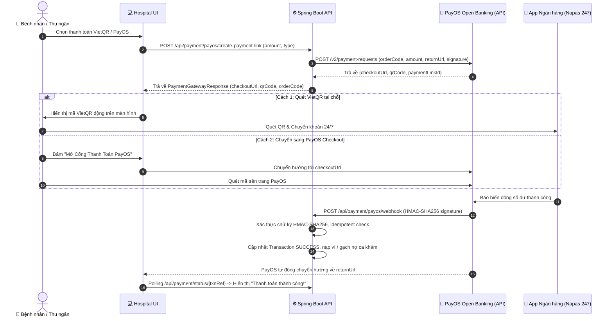

# 📋 KẾ HOẠCH TRIỂN KHAI (IMPLEMENTATION PLAN)
## Tích hợp Toàn diện Cổng Thanh toán PayOS Open Banking (Tài khoản Cá nhân)
### Tham khảo Kiến trúc từ dự án `revita-be`

> **Ngày lập:** 16/10/2026  
> **Dự án:** Hospital Management System (`hospital-api` & `hospital-ui`)  
> **Nguồn tham khảo:** `https://github.com/iamKhang/revita-be.git` (`@payos/node`, `invoice-payment.service.ts`)  
> **Mục tiêu:** Nâng cấp cổng thanh toán PayOS thành giải pháp Open Banking thực thụ với API chính thức của PayOS, sử dụng bộ API Keys tài khoản cá nhân của người dùng, hỗ trợ tạo Payment Link, VietQR động chuẩn Napas 247, Hosted Checkout URL, xác thực chữ ký Webhook HMAC-SHA256, tra cứu trạng thái đơn hàng trực tiếp và đối soát tự động.

---

### 1. Hiện Trạng & Phân Tích So Sánh Với `revita-be`

| Tiêu chí kỹ thuật | Hiện trạng tại `hospital-api` | Cách xử lý trong `revita-be` | Đề xuất triển khai nâng cấp |
| :--- | :--- | :--- | :--- |
| **1. Khởi tạo giao dịch PayOS** | Chỉ sinh ảnh tĩnh qua `img.vietqr.io`, chưa gọi API PayOS server-to-server. | Gọi API PayOS `POST /v2/payment-requests` để đăng ký đơn hàng chính thức với PayOS. | Triển khai `PayOSClientService` gọi API chính thức của PayOS để lấy `checkoutUrl`, `qrCode`, `paymentLinkId`. |
| **2. Tùy chọn giao diện thanh toán** | Chỉ có mã QR đơn giản trong popup. | Hỗ trợ cả 2 chế độ: Nhúng QR trực tiếp hoặc Chuyển hướng sang trang PayOS Checkout (`checkoutUrl`). | Cung cấp cả 2 lựa chọn: Quét VietQR trực tiếp tại chỗ (có polling tự động) HOẶC chuyển sang trang thanh toán chính hãng PayOS. |
| **3. Cấu hình API Keys cá nhân** | Đang để giá trị demo (`demo-client-id`). | Cấu hình qua `.env` với `PAYOS_CLIENT_ID`, `PAYOS_API_KEY`, `PAYOS_CHECKSUM_KEY`. | Cho phép cấu hình qua `application.yml` / biến môi trường `.env`, kèm cơ chế fallback an toàn (Offline VietQR Simulator) nếu chưa điền key thật. |
| **4. Xác thực Webhook HMAC-SHA256** | Đã có hàm tính toán HMAC-SHA256 cơ bản. | Chuẩn hóa sắp xếp alphabet các trường dữ liệu theo đặc tả PayOS trước khi tính băm. | Đồng bộ hóa thuật toán sort keys chuẩn PayOS (`amount`, `cancelUrl`, `description`, `orderCode`, `returnUrl`) để tương thích 100% với Webhook thật từ PayOS. |
| **5. Tra cứu trực tiếp trạng thái (Sync Polling)** | Chỉ tra cứu từ DB cục bộ. | Cho phép gọi `GET /v2/payment-requests/{id}` của PayOS để đối soát khi Webhook bị trễ. | Bổ sung API đồng bộ trực tiếp `/api/payment/payos/sync/{orderCode}` gọi sang PayOS để gạch nợ tức thì nếu Webhook mạng nội bộ gặp sự cố. |
| **6. Giao diện người dùng (Frontend)** | Chưa có nút chuyển hướng PayOS Checkout. | Có nút "Thanh toán qua PayOS" mở tab mới hoặc chuyển hướng. | Cập nhật `PaymentQRModal.jsx`, `PaymentPage.jsx`, `BookingPage.jsx` hiển thị đầy đủ thông tin VietQR và nút "Mở Cổng Thanh Toán PayOS". |

---

### 2. Chi Tiết Kiến Trúc Triển Khai (Technical Design)



---

### 3. Các File Cần Chỉnh Sửa & Bổ Sung

#### 1. Backend (`hospital-api`):
* **`PayOSConfig.java`**:
  * Đọc các biến cấu hình: `payos.client-id`, `payos.api-key`, `payos.checksum-key`, `payos.return-url`, `payos.cancel-url`.
  * Hàm tạo chữ ký tạo payment link (`amount`, `cancelUrl`, `description`, `orderCode`, `returnUrl`).
  * Hàm xác thực chữ ký Webhook theo chuẩn tài liệu PayOS.
* **`PayOSService.java` & `PayOSServiceImpl.java`**:
  * `createPaymentLink(Long orderCode, BigDecimal amount, String description, TransactionType type)`:
    * Gửi HTTP POST tới `https://api-merchant.payos.vn/v2/payment-requests` bằng Spring `RestClient` / `RestTemplate`.
    * Đính kèm Header: `x-client-id`, `x-api-key`.
    * Xử lý dự phòng (Graceful Fallback): Nếu tài khoản PayOS chưa active hoặc mất mạng ngoài, tự động fallback sang VietQR QuickLink để không làm gián đoạn luồng khám bệnh.
  * `getPaymentLinkInformation(Long orderCode)`: Tra cứu trạng thái đơn hàng trực tiếp từ PayOS.
  * `cancelPaymentLink(Long orderCode)`: Hủy link thanh toán trên PayOS khi đơn bị hủy.
* **`PaymentController.java` & `PaymentServiceImpl.java`**:
  * Nâng cấp endpoint `POST /api/payment/vietqr/create` và thêm `POST /api/payment/payos/create-link`.
  * Cập nhật `processPayOSWebhook`: Hỗ trợ đầy đủ payload thật từ PayOS webhook.
  * Bổ sung endpoint `POST /api/payment/payos/sync/{orderCode}` phục vụ đồng bộ thủ công.

#### 2. Frontend (`hospital-ui`):
* **`PaymentQRModal.jsx`**:
  * Bổ sung nút **"Mở Trang Thanh Toán PayOS"** (`checkoutUrl`) cho phép bệnh nhân chuyển sang giao diện chính hãng của PayOS nếu muốn.
  * Hiển thị mã đơn số (`orderCode`), số tài khoản ngân hàng và nội dung chuyển khoản rõ ràng.
  * Hiển thị trạng thái kết nối Webhook thời gian thực.
* **`PaymentPage.jsx` & `BookingPage.jsx`**:
  * Tích hợp lựa chọn kênh thanh toán PayOS VietQR.
  * Xử lý trang hoàn tất thanh toán khi PayOS chuyển hướng về `returnUrl` (`/payment?status=PAID&orderCode=...`).

---

### 4. Hướng Dẫn Cấu Hình Tài Khoản Cá Nhân PayOS

Khi triển khai xong, bạn chỉ cần mở file [`application.yml`](file:///c:/Users/ASUS/Downloads/hospital-api%20%281%29/hospital-api/src/main/resources/application.yml) (hoặc truyền qua biến môi trường) 3 thông số từ trang quản trị [PayOS Dashboard](https://my.payos.vn/):

```yaml
payos:
  client-id: ${PAYOS_CLIENT_ID:YOUR_CLIENT_ID_HERE}
  api-key: ${PAYOS_API_KEY:YOUR_API_KEY_HERE}
  checksum-key: ${PAYOS_CHECKSUM_KEY:YOUR_CHECKSUM_KEY_HERE}
  bank-bin: ${PAYOS_BANK_BIN:MB} # Mã ngân hàng của bạn (MB, VCB, TCB,...)
  bank-account: ${PAYOS_BANK_ACCOUNT:YOUR_ACCOUNT_NUMBER} # Số tài khoản ngân hàng của bạn
  account-holder: ${PAYOS_ACCOUNT_HOLDER:YOUR_FULL_NAME} # Tên chủ tài khoản (viết hoa không dấu)
```

---

### 5. Kế Hoạch Kiểm Thử Tự Động (Test Plan)
Viết kịch bản tự động `test_payos_real_integration.js`:
* **TC 1**: Khởi tạo giao dịch PayOS -> Kiểm tra nhận về `orderCode`, `qrCode`, `checkoutUrl`.
* **TC 2**: Giả lập Webhook PayOS với chữ ký HMAC-SHA256 hợp lệ -> Giao dịch chuyển sang `SUCCESS`, `isVerified = true`, lưu vết `webhookReference`.
* **TC 3**: Giả lập Webhook PayOS với chữ ký sai lệch -> Bị từ chối HTTP 400 Bad Request.
* **TC 4**: Thử nghiệm Idempotency: Gửi Webhook 2 lần liên tiếp -> Không bị cộng tiền/gạch nợ lần 2.
* **TC 5**: Tra cứu trạng thái đồng bộ PayOS -> Trả về kết quả khớp với sổ cái giao dịch.

---

### 6. Quy Trình Phê Duyệt
Theo quy tắc dự án, tôi **DỪNG LẠI** tại đây để bạn xem xét kế hoạch.  
Vui lòng phản hồi **"OK"** hoặc **"Triển khai đi"** để tôi bắt đầu thực hiện!
