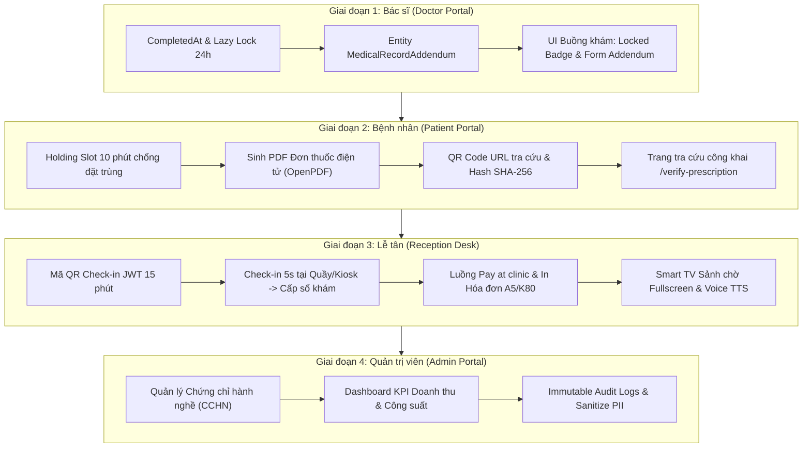

# 🏥 IMPLEMENTATION PLAN: TASK-16
## CHƯƠNG TRÌNH SỐ HÓA TOÀN DIỆN QUY TRÌNH Y TẾ 4 PHÂN HỆ
### (Tham khảo Kiến trúc E-healthcare & Quy định Bộ Y tế Việt Nam)

> **Mã công việc:** `TASK-16`  
> **Người thực hiện:** Senior Fullstack & Medical Solution Architect  
> **Mục tiêu:** Mở rộng và nâng cấp hệ thống **YOUMED TNT HOSPITAL** trên 4 phân hệ chính:  
> 1. **Phase 1: Doctor Portal** - Khóa bệnh án sau 24h & Phụ lục EMR Addendum (Thông tư 46/2018/TT-BYT).  
> 2. **Phase 2: Patient Portal** - Đặt lịch giữ slot 10 phút & Xuất Đơn thuốc điện tử PDF có QR xác thực Chữ ký số SHA-256.  
> 3. **Phase 3: Reception Desk** - Fast-track QR Check-in trong 5 giây, Thu viện phí tại quầy & Mẫu in Hóa đơn A5 / K80, Màn hình Smart TV chuyên dụng.  
> 4. **Phase 4: Admin Portal** - Quản lý Chứng chỉ hành nghề (CCHN), Dashboard KPI thời gian thực & Immutable Audit Logs (Append-only).  
> **Nguyên tắc cốt lõi:**  
> - Tuyệt đối giữ an toàn cho 38 JPA Entities hiện hữu (chỉ thêm bảng mới hoặc trường nullable, không phá vỡ schema cũ).  
> - Tuân thủ nghiêm ngặt quy trình: Lập kế hoạch chi tiết $\rightarrow$ Dừng lại xin ý kiến $\rightarrow$ Phê duyệt $\rightarrow$ Thực thi từng giai đoạn $\rightarrow$ Kiểm thử tự động (log thật) $\rightarrow$ Cập nhật tài liệu.

---

## 📌 PHÂN TÍCH TỔNG THỂ & THỰC THI THEO 4 GIAI ĐOẠN

---

## 🩺 GIAI ĐOẠN 1: BÁC SĨ (DOCTOR PORTAL) - KHÓA BỆNH ÁN 24H & EMR ADDENDUM (TT 46/2018/TT-BYT)

### 1. Cơ sở nghiệp vụ & Pháp lý
- **Thông tư 46/2018/TT-BYT (Điều 8 - Quản lý, sử dụng bệnh án điện tử):** Hồ sơ bệnh án sau khi bác sĩ hoàn thành khám và ký số được phép sửa đổi trong 24 giờ. Sau 24 giờ kể từ thời điểm kết thúc khám (`completedAt`), hồ sơ chuyển sang trạng thái **Khóa bất biến (`isLocked = true`)**.
- Mọi sửa đổi, bổ sung sau 24h bắt buộc phải lập **Phụ lục bệnh án (Addendum)**, lưu lại lý do sửa đổi, bác sĩ sửa, snapshot trước và sau, không được phép xóa sửa trực tiếp bản ghi gốc.

### 2. Kế hoạch triển khai Backend (Spring Boot)
1. **Cập nhật `MedicalExaminationRecord.java`:**
   - Thêm cột `completed_at` (`LocalDateTime` - Thời điểm hoàn tất khám).
   - Thêm cột `is_locked` (`Boolean` - Mặc định false).
   - Thêm helper method `checkAndApplyLazyLock()`: Nếu `completedAt` đã quá 24h $\rightarrow$ tự động set `isLocked = true`.
2. **Tạo Entity mới: `MedicalRecordAddendum.java`:**
   - `addendumId` (UUID, Primary Key).
   - `medicalRecord` (`@ManyToOne MedicalExaminationRecord`).
   - `doctor` (`@ManyToOne Doctor` - Bác sĩ tạo phụ lục).
   - `reason` (`TEXT` - Bắt buộc nhập lý do bổ sung theo TT 46).
   - `previousContent` (`TEXT` / `JSON` - Snapshot chẩn đoán, triệu chứng, hướng điều trị trước khi sửa).
   - `updatedContent` (`TEXT` / `JSON` - Snapshot sau khi bổ sung).
   - `createdAt` (`LocalDateTime`).
3. **Repository & Service:**
   - `MedicalRecordAddendumRepository.java`
   - Bổ sung logic vào `MedicalRecordService`:
     - Khi bác sĩ gọi `updateRecord`: Kiểm tra nếu `isLocked == true` hoặc `completedAt + 24h < now` $\rightarrow$ Ném lỗi `EMR_LOCKED_EXCEPTION` ("Bệnh án đã khóa sau 24h. Vui lòng lập Phụ lục bệnh án Addendum").
     - Endpoint mới: `POST /api/v1/medical-records/{id}/addendums` (Bác sĩ nhập lý do và nội dung bổ sung $\rightarrow$ lưu snapshot chuỗi).
     - Endpoint mới: `GET /api/v1/medical-records/{id}/addendums` (Lấy danh sách các phụ lục bệnh án theo thứ tự thời gian).

### 3. Kế hoạch triển khai Frontend (React)
- **Màn hình Bàn khám Bác sĩ (`DoctorExaminationPage.jsx`):**
  - Hiển thị nhãn cảnh báo: Nếu quá 24h $\rightarrow$ Huy hiệu màu đỏ `[ĐÃ KHÓA SAU 24H - CHỈ ĐỌC]`.
  - Ẩn/Disable các nút sửa trực tiếp, thay bằng nút **`+ Lập Phụ Lục Bệnh Án (Addendum)`**.
  - Modal form tạo Addendum: Nhập lý do (bắt buộc), cập nhật lại Chẩn đoán / Hướng điều trị / Lời dặn.
  - Tab "Lịch sử Phụ lục bệnh án": Hiển thị chuỗi timeline các lần bổ sung (Ai sửa, lúc mấy giờ, lý do gì, so sánh nội dung cũ vs mới).

---

## 📱 GIAI ĐOẠN 2: BỆNH NHÂN (PATIENT PORTAL) - GIỮ SLOT 10 PHÚT & ĐƠN THUỐC PDF CÓ QR KÝ SỐ

### 1. Cơ sở nghiệp vụ
- **Chống đặt trùng (Race condition):** Khi phòng khám có 100 người cùng truy cập đặt 1 bác sĩ nổi tiếng vào khung giờ vàng (ví dụ 8:30 sáng), hệ thống phải giữ chỗ tạm thời (Holding Slot) 10 phút cho người đầu tiên đi tới bước thanh toán. Nếu quá 10 phút chưa thanh toán xong, slot tự nhả cho người khác.
- **Đơn thuốc điện tử chuẩn Bộ Y tế:** Có mã đơn thuốc quốc gia, thông tin CCHN bác sĩ, liều dùng 4 cữ (Sáng - Trưa - Chiều - Tối), mã QR nhúng đường link xác thực chữ ký số SHA-256 (`/verify-prescription?code=...&hash=...`) để dược sĩ nhà thuốc kiểm tra tính nguyên vẹn.

### 2. Kế hoạch triển khai Backend (Spring Boot)
1. **Holding Slot 10 Phút:**
   - Trong `TimeSlot.java`: Thêm cột `holding_count` (`Integer`) hoặc quản lý qua Redis/Cache: `holding_expires_at` (`LocalDateTime`).
   - Endpoint `POST /api/v1/bookings/reserve-slot`: Giữ chỗ 10 phút, trả về `reservationToken` và thời gian hết hạn (`expiresAt = now + 10 phút`).
   - Khi thanh toán thành công (VNPAY / PayOS / Tiền mặt) $\rightarrow$ Chuyển thành `BookingStatus.CONFIRMED` và tăng `currentBookings`.
   - Scheduler ngầm (`@Scheduled(fixedRate = 60000)`): Quét các slot đang giữ mà quá hạn 10 phút chưa thanh toán $\rightarrow$ Hủy giữ chỗ.
2. **Sinh Đơn thuốc PDF có QR Code & Chữ ký số:**
   - Tích hợp OpenPDF (hoặc iText Core) trong `hospital-api`.
   - Service: `PrescriptionPdfService.java`:
     - Tạo mã băm SHA-256 từ `PrescriptionCode + DoctorId + CreatedAt`.
     - Sinh mã QR chứa link: `{publicUrl}/verify-prescription?code={code}&hash={hash}`.
     - Thiết kế layout PDF khổ A5 chuẩn Bộ Y tế (Thông tư 52/2017/TT-BYT & 04/2022/TT-BYT):
       - Header: Tên phòng khám, địa chỉ, số điện thoại, số giấy phép hoạt động.
       - Thông tin bệnh nhân: Họ tên, tuổi, giới tính, cân nặng (nếu trẻ em), số thẻ BHYT, chẩn đoán ICD-10.
       - Danh sách thuốc: Tên biệt dược, hoạt chất, hàm lượng, số lượng, liều dùng 4 cữ (Sáng, Trưa, Chiều, Tối), cách dùng trước/sau ăn.
       - Lời dặn của bác sĩ và ngày tái khám.
       - Chữ ký số của bác sĩ + Số CCHN + Mã QR xác thực.
   - Endpoint: `GET /api/v1/prescriptions/{code}/pdf` (Tải file PDF nhị phân).
   - Endpoint: `GET /api/v1/prescriptions/verify` (Kiểm tra chữ ký số công khai mà không để lộ bệnh án nhạy cảm).

### 3. Kế hoạch triển khai Frontend (React)
- **Quy trình đặt khám 4 bước (`BookingPage.jsx`):**
  - Bước 1: Chọn Chuyên khoa & Bác sĩ.
  - Bước 2: Chọn Ngày & Khung giờ khám (Slot).
  - Bước 3: Điền triệu chứng & Khai báo PHR $\rightarrow$ Hệ thống gọi `reserve-slot`, hiển thị bộ đếm ngược **`10:00`**.
  - Bước 4: Thanh toán (VNPAY / PayOS QR / Trả tại phòng khám).
- **Trang Tra Cứu Đơn Thuốc Công Khai (`VerifyPrescriptionPage.jsx`):**
  - Người dùng hoặc Dược sĩ quét mã QR trên đơn thuốc $\rightarrow$ Mở trang web hiển thị tick xanh: **"ĐƠN THUỐC HỢP LỆ & NGUYÊN VẸN"**, Ngày kê, Bác sĩ kê, Số CCHN, Phòng khám cấp.
- **Nút "Tải Đơn Thuốc PDF"** trong Lịch sử khám bệnh của Bệnh nhân.

---

## 🏢 GIAI ĐOẠN 3: LỄ TÂN (RECEPTION DESK) - CHECK-IN QR 5S, THU VIỆN PHÍ & IN HÓA ĐƠN A5/K80

### 1. Cơ sở nghiệp vụ
- **Giảm ùn tắc sảnh tiếp đón:** Bệnh nhân đã đặt lịch trước chỉ cần đưa mã QR trên điện thoại hoặc CCCD vào máy quét tại quầy $\rightarrow$ Trong 5 giây hệ thống tự động:
  1. Xác thực lịch hẹn hôm nay.
  2. Cấp ngay số thứ tự buồng khám (Queue Number).
  3. In phiếu khám nhiệt K80 ra máy in POS.
  4. Báo chuông ting-ting cho buồng khám của Bác sĩ.
- **Thu viện phí tại chỗ (`PAY_AT_CLINIC`):** Nếu bệnh nhân chọn trả tiền tại quầy, lễ tân nhận tiền mặt hoặc quét mã QR thanh toán $\rightarrow$ Chuyển trạng thái `PAID` $\rightarrow$ Tự động in Hóa đơn/Biên lai viện phí khổ A5.
- **Smart TV Sảnh Chờ:** Bảng hiển thị thông tin buồng khám và quầy tiếp đón độ phân giải cao, hỗ trợ giọng đọc TTS gọi số tự động.

### 2. Kế hoạch triển khai Backend (Spring Boot)
1. **Dynamic Check-in QR Token:**
   - Service cấp token check-in cho bệnh nhân (JWT ngắn hạn 15 phút, ký bằng secret riêng, có `jti` chống quét lại).
   - Endpoint: `POST /api/v1/reception/check-in/qr` (Nhận `qrToken` hoặc `bookingCode` $\rightarrow$ xác thực, chuyển `CHECKED_IN`, cấp `queueNumber`, trả về payload in vé K80).
2. **Thu viện phí tại quầy:**
   - Endpoint: `POST /api/v1/reception/collect-payment` (Cập nhật hóa đơn `PAID`, phương thức `CASH`/`POS_CARD`, kích hoạt check-in).
3. **Mẫu in Hóa đơn / Biên lai viện phí A5:**
   - Endpoint: `GET /api/v1/invoices/{id}/print-data` (Trả về dữ liệu in hóa đơn theo chuẩn kế toán tài chính).

### 3. Kế hoạch triển khai Frontend (React)
- **Màn hình Tiếp đón Lễ tân (`ReceptionDeskPage.jsx`):**
  - Khung quét mã QR Barcode cực nhạy (hỗ trợ camera hoặc súng bắn mã vạch USB 2D Scanner).
  - Tự động nhận diện trong 5 giây: Popup hiển thị thông tin bệnh nhân + Nút thu tiền nhanh + Tự động gửi lệnh in K80.
- **Mẫu in chuẩn CSS `@media print`:**
  - Phiếu nhiệt K80: Rộng 80mm, chữ số khám to rõ ràng, thông tin buồng khám và bác sĩ.
  - Hóa đơn A5: Biểu mẫu thanh toán viện phí chuẩn (A5 ngang/dọc, có bảng chi phí, chữ ký thu ngân và người nộp).
- **Màn hình Smart TV Sảnh Chờ Fullscreen (`QueueDisplayTvPage.jsx`):**
  - Chế độ 16:9 Fullscreen không có thanh công cụ trình duyệt, cập nhật WebSocket thời gian thực, đọc loa TTS khi có bệnh nhân mới được gọi.

---

## 📊 GIAI ĐOẠN 4: QUẢN TRỊ VIÊN (ADMIN PORTAL) - KPI, CCHN & IMMUTABLE AUDIT LOGS

### 1. Cơ sở nghiệp vụ
- **Quản lý Chứng chỉ hành nghề (CCHN):** Tuân thủ Điều 26 Luật Khám bệnh, chữa bệnh 2023. Bác sĩ bắt buộc phải có Số CCHN, phạm vi chuyên môn và ngày cấp.
- **Dashboard KPI thời gian thực:** Doanh thu theo cổng thanh toán, công suất phục vụ của từng bác sĩ/buồng khám, thời gian chờ trung bình của bệnh nhân.
- **Nhật ký an ninh bất biến (Immutable Audit Logs):** Bảng kiểm toán hoạt động theo nguyên tắc Append-only (chỉ ghi, cấm sửa/xóa), tự động lọc bỏ (sanitize) các thông tin nhạy cảm (mật khẩu, sinh hiệu, chẩn đoán bệnh án) để tuân thủ quy chuẩn bảo mật y tế.

### 2. Kế hoạch triển khai Backend (Spring Boot)
1. **Mở rộng Quản lý Bác sĩ:**
   - Thêm cột vào bảng `doctors`: `license_number` (Số CCHN), `scope_of_practice` (Phạm vi chuyên môn), `licensed_date` (Ngày cấp CCHN).
   - Validation: Khi phân ca trực hoặc kê đơn, bắt buộc kiểm tra bác sĩ có CCHN hợp lệ.
2. **Dashboard KPI Analytics:**
   - Endpoint: `GET /api/v1/admin/dashboard/kpi`
     - Tổng doanh thu theo ngày/tháng, phân loại: VNPay, PayOS, Tiền mặt.
     - Công suất buồng khám: Số ca khám hoàn tất, số ca hủy, tỷ lệ no-show.
     - Thời gian khám trung bình và thời gian bệnh nhân chờ đợi.
3. **Cơ chế Immutable Audit Logs:**
   - Entity `AuditLog.java`: Đánh dấu `@Immutable` (Hibernate) và cấm update/delete.
   - Service kiểm toán có bộ lọc regex:
     `/(clinical|vital|prescription|medicine|diagnos|token|cookie|secret|password|payload|body)/i`
     loại bỏ các thông tin nhạy cảm trước khi lưu metadata.

### 3. Kế hoạch triển khai Frontend (React)
- **Admin Dashboard KPI (`AdminDashboardPage.jsx`):**
  - Biểu đồ doanh thu đa kênh (Recharts / Chart.js).
  - Thẻ KPI công suất buồng khám và hiệu suất bác sĩ.
- **Quản lý Bác sĩ & CCHN (`DoctorManagementPage.jsx`):**
  - Thêm các trường nhập Số CCHN, ngày cấp, phạm vi hoạt động chuyên môn có badge kiểm thực.
- **Tra cứu Nhật ký An ninh (`AuditLogsPage.jsx`):**
  - Bảng tra cứu nhật ký kiểm toán với phân trang, lọc theo Actor, Hành động, Thời gian; hiển thị metadata sạch.

---

## 🧪 KẾ HOẠCH KIỂM THỬ TỰ ĐỘNG (TEST SUITE)
Mỗi giai đoạn sau khi hoàn thành sẽ có kịch bản kiểm thử tự động độc lập chạy trực tiếp trên hệ thống đang chạy (Port 8080):
1. `test_phase1_emr_addendum.js`: Kiểm tra khóa sau 24h, từ chối sửa trực tiếp, tạo và truy vấn chuỗi Addendum thành công.
2. `test_phase2_holding_slot_and_pdf.js`: Kiểm tra giữ slot 10 phút chống xung đột 2 người cùng đặt 1 slot, tải file PDF đơn thuốc và xác thực chữ ký SHA-256 qua API verify.
3. `test_phase3_qr_checkin_and_print.js`: Kiểm tra check-in QR 5s, cấp số thứ tự, thanh toán tại quầy và dữ liệu in hóa đơn A5.
4. `test_phase4_admin_kpi_audit.js`: Kiểm tra CCHN bác sĩ, truy vấn KPI và kiểm tra tính bất biến của Audit Log.
5. `test_regression_suite.js`: Chạy lại toàn bộ 3 test suites cũ (`test_counter_kiosk_workflow.js`, `test_cashier_workflow.js`, `test_security_hardening.js`) để đảm bảo không lỗi hồi quy (0 regression).

---

## 🚦 TRÌNH TỰ THỰC THI & QUY TẮC PHÊ DUYỆT

- **Bước 1 (Hiện tại):** Trình bày Kế hoạch tổng thể 4 giai đoạn $\rightarrow$ **Tạm dừng xin ý kiến người dùng**.
- **Bước 2 (Sau khi duyệt):** Thực hiện **Giai đoạn 1 (Doctor Portal: EMR Addendum TT 46)** $\rightarrow$ Chạy test $\rightarrow$ Báo cáo kết quả.
- **Bước 3:** Tiếp tục lần lượt **Giai đoạn 2**, **Giai đoạn 3**, **Giai đoạn 4**.
- **Bước 4:** Chạy kiểm thử hồi quy toàn diện, cập nhật `plan.md` và `memory.md`.
