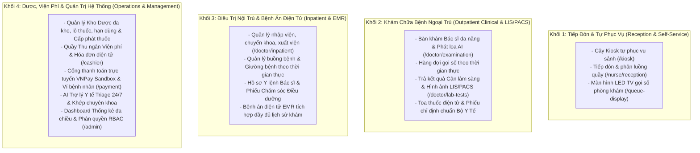

# 🗺️ MASTER-PLAN.MD - KẾ HOẠCH TỔNG QUAN TOÀN HỆ THỐNG
**Hệ Thống Quản Lý Bệnh Viện Thông Minh Toàn Diện - YOUMED TNT HOSPITAL**

> [!CAUTION]
> **QUY TẮC BẢO VỆ KẾ HOẠCH TỔNG QUAN (MASTER PLAN PROTECTION):**
> - File này là **Bản đồ chiến lược và Kế hoạch tổng thể toàn hệ thống** (System-Wide Master Plan & Strategic Roadmap).
> - **NGHIÊM CẤM GHI ĐÈ** file này khi thực hiện các task/module nhỏ lẻ hoặc khi lập kế hoạch sửa lỗi/tính năng mới.
> - Kế hoạch triển khai của từng tính năng/task cụ thể phải được viết ở file riêng (ví dụ `implementation_plan_*.md` hoặc trong thư mục `plans/`).

---

## 🏛️ I. KHUNG KIẾN TRÚC LỚN CỦA HỆ THỐNG (BIG FRAMEWORK)

Hệ thống được thiết kế theo mô hình **Bệnh viện số thông minh kết hợp đa kênh (Omnichannel Digital Hospital Platform)**, bao gồm 4 khối trụ cột công nghệ và 8 phân hệ nghiệp vụ:

---

## 📦 II. DANH MỤC CÁC MODULE TRỌNG YẾU (MODULAR BREAKDOWN MATRIX)

| Mã Module | Tên Phân Hệ / Module | Phạm vi tính năng chính | Trạng thái | Testing Plan File |
| :---: | :--- | :--- | :---: | :--- |
| **MOD-01** | **Quản lý Bác sĩ & Phân lịch trực** | CRUD Bác sĩ, học vị, chuyên khoa, tạo ca trực 14 ngày (Sáng/Chiều/Tối), tự sinh TimeSlots | ✅ Hoàn thành | [`test-plans/module_01_doctor_schedule.md`](file:///c:/Users/ASUS/Downloads/hospital-api%20%281%29/test-plans/module_01_doctor_schedule.md) |
| **MOD-02** | **Bàn khám Bác sĩ & Cận lâm sàng (LIS/PACS)** | Hàng đợi gọi số, gọi loa AI tiếng Việt + chuông ding-dong, chỉ định XN, KTV trả kết quả realtime | ✅ Hoàn thành | [`test-plans/module_02_doctor_queue_lab.md`](file:///c:/Users/ASUS/Downloads/hospital-api%20%281%29/test-plans/module_02_doctor_queue_lab.md) |
| **MOD-03** | **Điều trị Nội trú & Bệnh án điện tử EMR** | Nhập viện, quản lý giường bệnh, y lệnh bác sĩ, phiếu điều dưỡng, tổng kết xuất viện, hồ sơ EMR | ✅ Hoàn thành | [`test-plans/module_03_inpatient_emr.md`](file:///c:/Users/ASUS/Downloads/hospital-api%20%281%29/test-plans/module_03_inpatient_emr.md) |
| **MOD-04** | **Tiếp đón Điều dưỡng & Kiosk tự phục vụ** | Kiosk màn hình cảm ứng tự lấy số, phân luồng đối tượng ưu tiên, điều phối hàng đợi buồng khám | ✅ Hoàn thành | [`test-plans/module_04_kiosk_reception.md`](file:///c:/Users/ASUS/Downloads/hospital-api%20%281%29/test-plans/module_04_kiosk_reception.md) |
| **MOD-05** | **AI Trợ lý Y tế Triage 24/7 & Tư vấn** | Phân loại cấp cứu/khẩn cấp, phát hiện triệu chứng, tư vấn sơ cứu, gợi ý chuyên khoa & đặt khám 1-Click | ✅ Hoàn thành | [`test-plans/module_05_ai_triage.md`](file:///c:/Users/ASUS/Downloads/hospital-api%20%281%29/test-plans/module_05_ai_triage.md) |
| **MOD-06** | **Quản lý Kho Dược & Cấp phát thuốc** | Kho thuốc tổng, kho lẻ, theo dõi hạn dùng/lô thuốc, cảnh báo hết hạn, quy trình cấp phát toa | ✅ Hoàn thành | [`test-plans/module_06_pharmacy_inventory.md`](file:///c:/Users/ASUS/Downloads/hospital-api%20%281%29/test-plans/module_06_pharmacy_inventory.md) |
| **MOD-07** | **Thanh toán Viện phí & Cổng VNPay** | Thanh toán VNPay-QR Sandbox, nạp tiền ví bệnh nhân, quầy thu ngân tiền mặt, xuất phiếu thu | ✅ Hoàn thành | [`test-plans/module_07_payment_cashier.md`](file:///c:/Users/ASUS/Downloads/hospital-api%20%281%29/test-plans/module_07_payment_cashier.md) |
| **MOD-08** | **Cổng Bệnh nhân (Patient Portal)** | Hồ sơ gia đình đa đối tượng, tra cứu bệnh án cũ qua CCCD, sổ nhắc uống thuốc 4 cữ | ✅ Hoàn thành | [`test-plans/module_08_patient_portal.md`](file:///c:/Users/ASUS/Downloads/hospital-api%20%281%29/test-plans/module_08_patient_portal.md) |
| **MOD-09** | **Quản trị Quản lý & Dashboard Báo cáo** | Thống kê doanh thu, tỷ trọng bệnh nhân, quản lý tài khoản RBAC, cấu hình buồng phòng & dịch vụ | ✅ Hoàn thành | [`test-plans/module_09_admin_dashboard.md`](file:///c:/Users/ASUS/Downloads/hospital-api%20%281%29/test-plans/module_09_admin_dashboard.md) |

---

## 🎯 III. LỘ TRÌNH PHÁT TRIỂN & MỞ RỘNG TIẾP THEO (EXPANSION ROADMAP)

Khi có yêu cầu phát triển mới hoặc nâng cấp hệ thống, toàn bộ quy trình phải tuân thủ nghiêm ngặt 5 giai đoạn:

### Giai đoạn mở rộng tiềm năng (Future Phases):
1. **Phase 10 - Tích hợp Thông báo Đa kênh (Omnichannel Notifications):**
   - Tích hợp SMS OTP / Zalo ZNS / Web Push Notifications cho lịch khám và nhắc nhở uống thuốc.
2. **Phase 11 - Phân tích Dữ liệu Lớn & Báo cáo Thông minh (Advanced BI & Analytics):**
   - Dự báo lưu lượng bệnh nhân theo mùa dịch, tối ưu hóa phân bổ nhân sự bác sĩ.
3. **Phase 12 - Chuẩn hóa Liên thông Dữ liệu Y tế Quốc tế (HL7 FHIR Compliance):**
   - Hỗ trợ xuất/nhập hồ sơ sức khỏe theo chuẩn HL7 / FHIR để liên thông với các bệnh viện tuyến trên.

---

## 📐 IV. TIÊU CHUẨN NGHIỆM THU TỪNG MODULE (MODULE ACCEPTANCE CRITERIA)

Mỗi module khi triển khai mới hoặc nâng cấp bắt buộc phải vượt qua checklist:
- [ ] **Khung thiết kế (Design):** Đã phân tích tác động, không phá vỡ cấu trúc entity hiện có.
- [ ] **Implementation Plan:** Đã trình bày kế hoạch chi tiết và **được người dùng phê duyệt**.
- [ ] **Mã nguồn (Clean Code):** Viết đầy đủ, không viết tắt, tuân thủ chuẩn Clean Code & Spring/React conventions.
- [ ] **Kiểm thử tự động (Automation Test):** Có script kiểm thử Node.js hoặc JUnit pass 100%.
- [ ] **Lưu trữ Testing Plan:** Cập nhật hoặc tạo mới file test plan chi tiết trong thư mục `test-plans/`.
- [ ] **Cập nhật trạng thái:** Cập nhật tiến độ vào file `plan.md` và `memory.md`.
