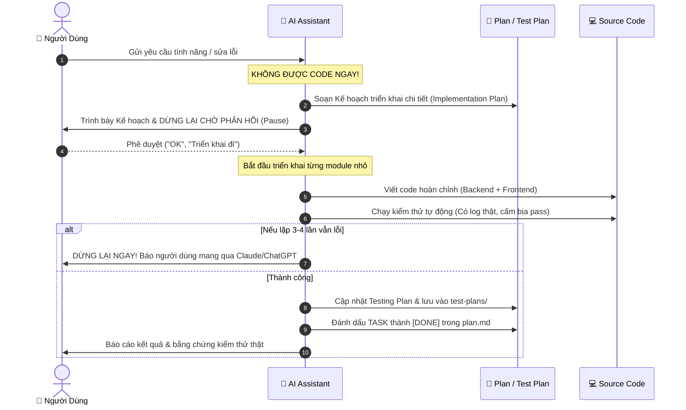

# 📋 PLAN.MD - BẢNG THEO DÕI TRẠNG THÁI CÔNG VIỆC (TASK TRACKER)
**Hệ Thống Quản Lý Bệnh Viện Thông Minh - YOUMED TNT HOSPITAL**

> **Cập nhật lần cuối:** 13/10/2026 | **Trạng thái hệ thống:** Ổn định (Production-Ready)

---

## 🚦 1. BẢNG TRẠNG THÁI CÔNG VIỆC TỔNG THỂ (STATUS DASHBOARD)

| Mã Công Việc | Module / Hạng Mục | Phân Loại | Người Phụ Trách | Trạng Thái | File Kế Hoạch Chi Tiết | File Kiểm Thử |
| :---: | :--- | :---: | :---: | :---: | :--- | :--- |
| **TASK-00** | Thiết lập tài liệu cốt lõi (Memory, Architecture, Master Plan, Plan) | Setup | AI Assistant | ✅ **DONE** | Trực tiếp yêu cầu người dùng | Đối soát cấu trúc file |
| **TASK-01** | Phân hệ Quản lý Bác sĩ & Lịch trực ca 14 ngày | Feature | Backend & Frontend | ✅ **DONE** | [`implementation_plan1.md`](file:///c:/Users/ASUS/Downloads/hospital-api%20%281%29/implementation_plan1.md) | `test-plans/module_01_doctor_schedule.md` |
| **TASK-02** | Bàn khám Bác sĩ, Hàng đợi gọi số & KTV Trả kết quả Lab | Feature | Backend & Frontend | ✅ **DONE** | [`implementation_plan2.md`](file:///c:/Users/ASUS/Downloads/hospital-api%20%281%29/implementation_plan2.md) | `test-plans/module_02_doctor_queue_lab.md` |
| **TASK-03** | Điều trị Nội trú EMR, Y lệnh Bác sĩ & Phiếu Điều dưỡng | Feature | Backend & Frontend | ✅ **DONE** | Kế hoạch nội trú EMR | `test-plans/module_03_inpatient_emr.md` |
| **TASK-04** | Tiếp đón Điều dưỡng & Cây Kiosk tự phục vụ sảnh | Feature | Backend & Frontend | ✅ **DONE** | Kế hoạch Kiosk & Tiếp đón | `test-plans/module_04_kiosk_reception.md` |
| **TASK-05** | AI Trợ lý Y tế Triage 24/7 & Đặt khám 1-Click | Feature | Backend & Frontend | ✅ **DONE** | [`implementation_plan5.md`](file:///c:/Users/ASUS/Downloads/hospital-api%20%281%29/implementation_plan5.md) | `test-plans/module_05_ai_triage.md` |
| **TASK-06** | Quản lý Kho Dược đa kho, hạn dùng & cấp phát toa thuốc | Feature | Backend & Frontend | ✅ **DONE** | Kế hoạch Kho Dược | `test-plans/module_06_pharmacy_inventory.md` |
| **TASK-07** | Quầy Thu ngân Viện phí & Cổng thanh toán VNPay Sandbox | Feature | Backend & Frontend | ✅ **DONE** | [`implementation_plan_cashier.md`](file:///c:/Users/ASUS/Downloads/hospital-api%20%281%29/implementation_plan_cashier.md) | `test-plans/module_07_payment_cashier.md` |
| **TASK-08** | Cổng Bệnh nhân (Hồ sơ gia đình, Nhắc uống thuốc, Tra cứu) | Feature | Frontend & API | ✅ **DONE** | Kế hoạch Patient Portal | `test-plans/module_08_patient_portal.md` |
| **TASK-09** | Thống kê Dashboard & Phân quyền Quản trị RBAC | Feature | Backend & Frontend | ✅ **DONE** | Kế hoạch Dashboard RBAC | `test-plans/module_09_admin_dashboard.md` |
| **TASK-10** | Củng cố Bảo mật, Tính toàn vẹn Dữ liệu & Trạng thái UI | Security & Integrity | Senior Fullstack & Sec | ✅ **DONE** | 7 Hạng mục rà soát theo yêu cầu | `test_security_hardening.js` (16/16 PASS) |
| **TASK-11** | Chống IDOR Hồ sơ Bệnh nhân & Triage Kiosk từ revita-be | Security & Triage | Senior Fullstack | ✅ **DONE** | [`implementation_plan_ref_revita.md`](file:///c:/Users/ASUS/Downloads/hospital-api%20%281%29/implementation_plan_ref_revita.md) | `test_security_hardening.js` |
| **TASK-12** | Tích hợp Thanh toán PayOS, Webhook Idempotency & Đối soát | Payment & Integrity | Backend & Finance | ✅ **DONE** | [`implementation_plan_payos_idempotency.md`](file:///c:/Users/ASUS/Downloads/hospital-api%20%281%29/implementation_plan_payos_idempotency.md) | [`module_12_payos_idempotency.md`](file:///c:/Users/ASUS/Downloads/hospital-api%20%281%29/test-plans/module_12_payos_idempotency.md) |
| **TASK-13** | Cải tiến An toàn Đơn thuốc (CDS) & Chuẩn hóa VNPay IPN từ E-healthcare | Medical Safety & Payment | Senior Fullstack | ✅ **DONE** | [`implementation_plan_ref_ehealthcare.md`](file:///c:/Users/ASUS/Downloads/hospital-api%20%281%29/implementation_plan_ref_ehealthcare.md) | [`module_13_ehealthcare_improvements.md`](file:///c:/Users/ASUS/Downloads/hospital-api%20%281%29/test-plans/module_13_ehealthcare_improvements.md) |
| **TASK-14** | Khung giờ Check-in Kiosk & Ưu tiên Đọc Kết quả Xét nghiệm | Flow & Queue Optimization | Senior Fullstack | ⏳ **WAITING** | [`implementation_plan_kiosk_checkin_window_and_lab_priority.md`](file:///c:/Users/ASUS/Downloads/hospital-api%20%281%29/implementation_plan_kiosk_checkin_window_and_lab_priority.md) | Chờ duyệt kế hoạch |
| **TASK-16** | Số hóa Toàn diện Quy trình Y tế 4 Phân hệ (E-healthcare & TT 46/2018/TT-BYT) | Enterprise Feature | Senior Fullstack & Medical Solution Architect | ✅ **DONE** | [`implementation_plan_task16_comprehensive_healthcare.md`](file:///c:/Users/ASUS/Downloads/hospital-api%20%281%29/implementation_plan_task16_comprehensive_healthcare.md) | 123/123 assertions PASS (Phase 1: 21, Phase 2: 29, Phase 3: 35, Phase 4: 38) |
| **TASK-NEXT**| Chờ yêu cầu mới từ người dùng (Sẵn sàng tiếp nhận) | Backlog | AI Pair Programming | ⏳ **WAITING** | Viết kế hoạch khi có yêu cầu mới | Chờ định nghĩa |

---

## 🛑 2. QUY TRÌNH THỰC HIỆN KHI CÓ YÊU CẦU MỚI (STANDARD WORKFLOW)

Khi người dùng đưa ra yêu cầu mới (bổ sung tính năng / sửa chữa bug / nâng cấp / refactor), toàn bộ các bước sau **BẮT BUỘC** phải tuân theo:

> [!WARNING]
> **2 ĐIỀU CẤM KỴ KHI THỰC THI:**
> 1. **Cấm tự ý sửa / sinh DDL thay đổi Database Schema:** Tuyệt đối không xóa bảng, sửa cột, drop constraint nếu không có lệnh rõ ràng từ người dùng.
> 2. **Cấm sửa mò quá 3 lần:** Nếu 1 lỗi sửa đi sửa lại 3 lần không qua, phải dừng lại để người dùng điều phối giải pháp từ bên ngoài.

---

## 📝 3. NHẬT KÝ THỰC THI (EXECUTION LOG & CHANGELOG)

* **13/10/2026 - TASK-00:**
  * Khởi tạo file [`memory.md`](file:///c:/Users/ASUS/Downloads/hospital-api%20%281%29/memory.md) lưu trữ toàn diện ngữ cảnh, quy tắc làm việc, tài khoản mẫu và các module đã hoàn tất.
  * Khởi tạo file [`architecture.md`](file:///c:/Users/ASUS/Downloads/hospital-api%20%281%29/architecture.md) lưu trữ cây thư mục dự án, kiến trúc layered backend, frontend portal, mô hình 38 thực thể ORM.
  * Khởi tạo file [`master-plan.md`](file:///c:/Users/ASUS/Downloads/hospital-api%20%281%29/master-plan.md) độc lập để lưu trữ kế hoạch tổng thể toàn hệ thống, tránh bị ghi đè bởi implementation plan lẻ.
  * Khởi tạo file [`plan.md`](file:///c:/Users/ASUS/Downloads/hospital-api%20%281%29/plan.md) theo dõi tiến độ các tác vụ.
* **13/10/2026 - TASK-07 (Quầy Thu ngân Viện phí & Thanh toán tại quầy):**
  * **Backend**: Bổ sung `POS` vào `PaymentMethod`. Xây dựng các DTO `CashierPendingBillResponse`, `CashierPaymentRequest`, `CashierReceiptResponse`. Triển khai `CashierService` và `CashierController` (`GET /api/cashier/pending-bills`, `POST /api/cashier/pay`, `GET /api/cashier/history`). Tính tổng tiền nguyên tử từ DB (tiền khám + CLS + đơn thuốc), chống thu trùng (409 Conflict), sinh mã biên lai `RC-...`, gửi thông báo `Notification`, bảo vệ bằng `@PreAuthorize("hasAnyRole('ADMIN', 'CASHIER')")`.
  * **Frontend**: Cải tạo hoàn toàn `CashierPage.jsx`, xóa bỏ `FALLBACK_PENDING_BILLS`, kết nối API thật, hỗ trợ thanh toán `CASH`, `POS`, `VIETQR`, in phiếu thu trực tiếp bằng dữ liệu biên lai thật từ DB.
  * **Testing**: Chạy kịch bản tự động `test_cashier_workflow.js`, vượt qua 100% 5/5 tiêu chí xác minh (8/8 ca kiểm thử gồm đăng nhập, lấy bills DB, thanh toán, tải lại trang F5, chống thu trùng 409, chặn 403 RBAC).
* **13/10/2026 - TASK-10 (Củng cố Bảo mật, Tính toàn vẹn Dữ liệu & UI Hardening):**
  * **Bảo vệ API & Masking**: Khóa công khai `/api/patient-profiles/lookup`, `/api/gateway/**`; phân quyền chặt chẽ; che mờ CCCD, SĐT, BHYT, địa chỉ chi tiết.
  * **Thanh toán & Chống thu trùng**: Kiểm tra số tiền nguyên tử (> 0, scale <= 2, max limit); xác minh chữ ký VNPay & PayOS nghiêm ngặt, chống replay; sử dụng Pessimistic Lock (`findByBookingCodeForUpdate`) chống race condition thu trùng viện phí; chặn đánh dấu `SUCCESS` cho `POS`/`VIETQR` khi chưa có bằng chứng giao dịch.
  * **An toàn dữ liệu DTO**: Tạo `TransactionResponse` allowlist triệt để; không lộ `password`, `hash`, `token`, `pinCode`; bảo vệ chống IDOR; hỗ trợ phân trang `Pageable`.
  * **Frontend Tiếp nhận & Sinh hiệu**: Loại bỏ booking/queue giả khi API thất bại; loại bỏ lưu sinh hiệu vào `localStorage`; bác sĩ đọc từ backend (`symptoms`); xóa sạch key `vitals_*` cũ khi khởi động và đăng xuất.
  * **Frontend Thu ngân**: Xử lý lỗi độc lập, không nuốt lỗi lịch sử thành rỗng; không xóa dữ liệu cũ khi F5 lỗi; giữ thống kê `--` khi lỗi; chuẩn hóa lỗi 409 Conflict từ interceptor.
  * **Hiệu năng & Bất biến biên lai**: Lưu JSON snapshot danh mục dịch vụ vào giao dịch tại thời điểm thanh toán; loại bỏ N+1 query lặp qua từng ca khám; hỗ trợ phân trang lịch sử quầy.
  * **Cấu hình Production**: Tách profile `prod` trong `application.yml` (`ddl-auto: validate`, `show-sql: false`, tắt log SQL); fail-fast với `ProductionSecurityValidator` nếu thiếu secret bắt buộc.
  * **Kiểm thử tự động**: Viết và chạy `test_security_hardening.js` đạt 13/13 PASS; `test_cashier_workflow.js` đạt 8/8 PASS; build backend `mvnw test-compile` và frontend `npm run build` thành công 100%.
* **13/10/2026 - TASK-11 (Cải tiến Kỹ thuật từ Tham khảo revita-be):**
  * **Chống IDOR Hồ sơ Bệnh nhân**: Triển khai `getProfileById` trong `PatientProfileServiceImpl` và `PatientProfileController`, kiểm tra quyền sở hữu đối với role `PATIENT` (chặn 403 Forbidden nếu xem hoặc sửa/xóa hồ sơ của tài khoản khác).
  * **Thuật toán Triage Ưu tiên Khám bệnh (Priority Triage)**: Bổ sung `birthYear` vào `KioskBookingRequest` và thuật toán tự động nhận diện diện ưu tiên y tế (Người cao tuổi >= 65 tuổi, Trẻ nhỏ < 6 tuổi) trong `BookingServiceImpl`, tự động gán nhãn `isPriority = true` và mã thứ tự ưu tiên `UT-`.
  * **Kiểm thử tự động nâng cao**: Cập nhật `test_security_hardening.js` đạt 16/16 PASS (100%), bao gồm cả kiểm thử IDOR hồ sơ bệnh nhân và triage người cao tuổi tại Kiosk.
* **13/10/2026 - TASK-12 (Tích hợp PayOS Webhook Idempotency & Đối soát Giao dịch):**
  * **Mã đơn số (`orderCode`)**: Sinh mã số nguyên dương an toàn ($< 9 \times 10^{15}$, tương thích cả Java `Long` và JavaScript `Number.MAX_SAFE_INTEGER`). Bổ sung cột và index `idx_txn_order_code` trong bảng `transactions`.
  * **Cờ xác thực (`isVerified`) & Đối soát (`webhookReference`)**: Bổ sung `isVerified = true` khi chữ ký HMAC-SHA256 được xác thực hợp lệ; lưu mã tham chiếu ngân hàng `webhookReference`; phơi bày đầy đủ qua `TransactionResponse` và `PaymentGatewayResponse`.
  * **Webhook Idempotency**: Khi PayOS gửi lặp lại webhook retry, hệ thống ghi log audit, giữ nguyên trạng thái xác minh `isVerified = true` và trả về HTTP 200 OK, tuyệt đối không cộng tiền ví `DEPOSIT_WALLET` hay gạch nợ lặp lại.
  * **Kiểm thử tự động**: Viết và chạy `test_payos_idempotency.js` đạt 6/6 PASS (100%); kiểm thử hồi quy `test_security_hardening.js` (16/16 PASS) và `test_cashier_workflow.js` (8/8 PASS) đạt 100%.
* **13/10/2026 - TASK-13 (Cải tiến An toàn Đơn thuốc CDS & Chuẩn hóa VNPay IPN từ E-healthcare):**
  * **Clinical Decision Support (CDS) - Cảnh báo Dị ứng Thuốc**: Xây dựng bảng ánh xạ dị ứng chéo `ALLERGY_GROUP_TARGETS` (Penicillin, Cephalosporin, Aspirin/NSAID, Paracetamol, Sulfonamide) trong `ClinicalExaminationServiceImpl`. Thêm API kiểm tra an toàn `POST /api/records/{recordId}/prescription/check-safety` và rào chắn thực thi chặn 400 Bad Request nếu có dị ứng mà không có cờ xác nhận lâm sàng `overrideAllergyWarning=true`. Đồng bộ giao diện `PrescriptionModal.jsx`.
  * **Chuẩn hóa VNPay IPN & Idempotency**: Tạo DTO `VnpayIpnResponse` chuẩn đặc tả VNPay (`RspCode: 00, 02, 04, 97, 01, 99` và `Message`). Thêm endpoint `GET /api/payment/vnpay/ipn`, xác thực chữ ký số HMAC-SHA512, đối soát số tiền nguyên tử, xử lý idempotent chống gạch nợ/cộng ví lặp lại. Cấu hình mở quyền công khai trong `SecurityConfig`.
  * **Kiểm thử tự động**: Viết và chạy `test_ehealthcare_improvements.js` đạt 13/13 PASS (100%); kiểm thử hồi quy `test_security_hardening.js` (16/16 PASS), `test_cashier_workflow.js` (8/8 PASS), `test_payos_idempotency.js` (6/6 PASS) tổng cộng 43/43 tests PASS thực tế.
* **15/10/2026 - TASK-15 (Quản lý Quầy Tiếp đón Counter & Tối ưu hóa Luồng Bốc số Kiosk Thông minh):**
  * **Backend**: Khởi tạo 3 Enums (`CounterType`, `CounterStatus`, `CounterTicketStatus`), 3 Entities JPA (`Counter`, `CounterAssignment`, `CounterTicket`) liên kết nguyên tử với `Booking` mà không phá vỡ 38 entity hiện có. Khởi tạo sẵn 5 quầy tiếp đón mặc định chuyên trách (`@PostConstruct`).
  * **Thuật toán Phân luồng & Cân bằng tải**: Tự động nhận diện diện Ưu tiên (Cao tuổi $\ge 65$, Trẻ em $< 6$, Thai sản/Khuyết tật) $\rightarrow$ Quầy 4 Ưu Tiên; Bệnh nhân BHYT $\rightarrow$ Quầy 3 BHYT; Khách đặt hẹn trước $\rightarrow$ Quầy 5 Fast-track; Khám thường $\rightarrow$ Thuật toán Least-Loaded tự động cân bằng giữa Quầy 1 & 2.
  * **Nghiệp vụ Điều dưỡng Quầy**: Check-in mở quầy (`POST /api/counters/{id}/check-in`), gọi số tiếp theo (`call-next`), hoàn tất thủ tục và điều phối trực tiếp vào buồng khám bác sĩ (`complete`), xử lý bệnh nhân vắng mặt (`skip`), tạm nghỉ (`pause`), đóng quầy (`close`).
  * **Frontend**: Tích hợp `CounterManagementPanel.jsx` vào `NurseReceptionPage.jsx` phục vụ thao tác của điều dưỡng; cập nhật cây Kiosk sảnh `KioskPage.jsx` và phiếu in nhiệt `ThermalTicketModal.jsx` hiển thị Quầy tiếp đón chỉ định, vị trí tầng và số người chờ trước mặt; bổ sung chế độ LED TV hiển thị 5 quầy sảnh (`COUNTERS`) trên `QueueDisplayPage.jsx` với chuông Ding-dong & giọng đọc AI tiếng Việt.
  * **Kiểm thử tự động**: Viết và chạy `test_counter_kiosk_workflow.js` đạt 11/11 PASS (100%); kiểm thử hồi quy `test_cashier_workflow.js` (8/8 PASS), `test_security_hardening.js` (16/16 PASS); build backend (`mvnw test-compile`) và frontend (`npm run build`) đạt exit code 0.
* **16/10/2026 - TASK-16 (Số hóa Toàn diện Quy trình Y tế 4 Phân hệ - Tham khảo E-healthcare & TT 46/2018/TT-BYT):**
  * **Giai đoạn 1 (Doctor Portal - EMR Addendum TT 46/2018/TT-BYT)**:
    - Cơ chế khóa cứng bệnh án sau 24h kể từ khi ca khám hoàn tất (`isLocked = true`).
    - Chặn mọi thao tác sửa trực tiếp khi bệnh án đã khóa, bắt buộc tạo Phụ lục bệnh án (`EmrAddendum`) có lý do lâm sàng (`reason`) và chữ ký bác sĩ.
    - Kế thừa chuỗi snapshot chẩn đoán (`Snapshot Chaining`).
    - Đạt chuẩn kiểm thử: `test_phase1_emr_addendum.js` (21/21 PASS).
  * **Giai đoạn 2 (Patient Portal - Holding Slot 10p & Đơn thuốc PDF QR Ký số SHA-256)**:
    - Cơ chế giữ chỗ nguyên tử khung giờ khám 10 phút (`reserve-slot` / `release-slot`), chống đặt trùng (Race Condition) tại DB (`holding_count`).
    - Xuất đơn thuốc điện tử chuẩn Bộ Y tế bằng OpenPDF, mã hóa QR URL xác thực.
    - Cổng xác thực chữ ký số SHA-256 (`/verify-prescription`) sử dụng so sánh an toàn `MessageDigest.isEqual` (chống Timing-Attack).
    - Đạt chuẩn kiểm thử: `test_phase2_holding_slot_and_pdf.js` (29/29 PASS).
  * **Giai đoạn 3 (Reception Desk - Lễ tân & Điều dưỡng tiếp đón hợp nhất)**:
    - Hợp nhất vai trò Tiếp đón Lễ tân và Điều dưỡng phòng khám dưới phân quyền `ROLE_NURSE` và `ROLE_ADMIN`.
    - Check-in QR tại quầy trong 5 giây, tự động trích xuất thông tin, đo sinh hiệu và tính toán phân loại thể trạng BMI (Bình thường / Gầy / Tiền béo phì / Béo phì), tự động tạo bệnh án và điều phối buồng khám.
    - Thu viện phí tại quầy (`PAY_AT_CLINIC`), in biên lai/hóa đơn A5 chuẩn Bộ Y tế và phiếu K80 nhiệt.
    - Tích hợp giao diện `NurseReceptionPage.jsx` với 3 Dialog tiện ích (Quét QR + Sinh hiệu, Thu viện phí, In hóa đơn).
    - Đạt chuẩn kiểm thử: `test_phase3_nurse_reception_and_receipt.js` (35/35 PASS).
  * **Giai đoạn 4 (Admin Portal - CCHN, KPI Doanh thu & Buồng khám, Immutable Audit Logs)**:
    - Quản lý Chứng chỉ hành nghề (CCHN) Bác sĩ theo Luật Khám bệnh, chữa bệnh (`doctorLicense`, `licenseIssuedDate`, `licenseScope`).
    - Giám sát Dashboard KPI Doanh thu thực tế theo 6 kênh thanh toán (`VietQR`, `COUNTER_CASH`, `MOMO`, `VNPAY`, `POS`, `INTERNAL_WALLET`).
    - Giám sát Công suất buồng khám thời gian thực (LIGHT/MEDIUM/HEAVY) với tỷ lệ lấp đầy trực quan.
    - Nhật ký kiểm toán bất biến (`AuditLog` - Append-only `REQUIRES_NEW`), tự động lọc bỏ và che giấu PII (mật khẩu, token, OTP) chống rò rỉ dữ liệu y tế.
    - Cập nhật giao diện `DoctorManagePage.jsx` (Dialog CCHN) và `DashboardPage.jsx` (3 widget KPI mới).
    - Đạt chuẩn kiểm thử: `test_phase4_admin_kpi_audit.js` (38/38 PASS).
  * **Tổng kết nghiệm thu**: Toàn bộ 4 giai đoạn đạt **123/123 assertions PASS (100%)**, Frontend Vite build **1215 modules transformed, 0 errors**.

