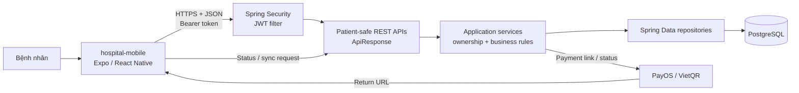
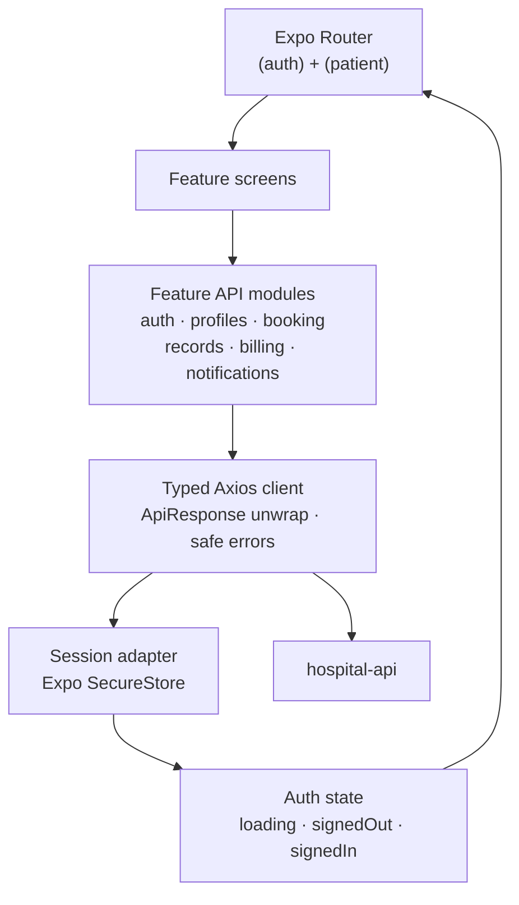

# Kiến trúc ứng dụng mobile cho bệnh nhân

> **Trạng thái:** App đã triển khai MVP; Android preview build và smoke giới hạn đã PASS, full Android E2E chưa xác minh, iOS build đang BLOCKED  
> **Cập nhật:** 08-11-2026  
> **Đặc tả gốc:** [`2026-11-07-patient-mobile-app-design.md`](../../../../docs/superpowers/specs/2026-11-07-patient-mobile-app-design.md)  
> **Kế hoạch chương trình:** [`patient-mobile-app-follow-up_UMBRELLA_PLAN_07-11-26.md`](../active/patient-mobile-app-follow-up_UMBRELLA_PLAN_07-11-26.md)

## 1. Mục tiêu và ranh giới

`hospital-mobile` là ứng dụng bệnh nhân cho Android và iOS, được xây mới bằng Expo và TypeScript. App gọi `hospital-api` qua REST/JSON. Dự án `TheDuckHospitalReactNative` chỉ làm mẫu cho điều hướng và thứ tự luồng; không sao chép API service, xác thực, dữ liệu mẫu hoặc màn hình quản trị.

Backend hiện vẫn là nguồn dữ liệu và quyết định nghiệp vụ duy nhất cho hồ sơ, lịch khám, bệnh án, hóa đơn và trạng thái thanh toán. App không tự tính số tiền, tự xác định kết quả lâm sàng, hay coi trạng thái gửi từ deep link là trạng thái giao dịch cuối cùng.



## 2. Cấu trúc bên trong app



Trách nhiệm được chia theo lớp:

- **Routes và screens:** điều hướng, nhập liệu, trạng thái tải/rỗng/lỗi, trình bày dữ liệu do server trả về.
- **Feature modules:** kiểu DTO và hàm gọi API cho từng luồng; không giữ logic bảo mật hoặc tính phí ở giao diện.
- **API client:** một Axios instance, base URL theo môi trường, Bearer header, chuẩn hóa `ApiResponse<T>`, xử lý timeout và HTTP 401.
- **Session adapter:** lưu/xóa access token bằng OS secure storage; không dùng AsyncStorage, Realm hoặc localStorage.
- **Server:** xác minh vai trò `ROLE_PATIENT`, quyền sở hữu hồ sơ và booking, số dư hóa đơn, trạng thái giao dịch.

## 3. Cấu trúc thư mục hiện tại (rút gọn)

App đã được triển khai dưới `hospital-mobile/`. Cây dưới đây tóm tắt cấu trúc hiện tại; màn đăng ký/khôi phục mật khẩu và push notification vẫn thuộc các phase tiếp theo.

```text
hospital-mobile/
├── app.json
├── package.json
├── .env.example
└── src/
    ├── app/
    │   ├── (auth)/login.tsx
    │   ├── (patient)/_layout.tsx
    │   ├── (patient)/index.tsx
    │   ├── (patient)/profiles/
    │   ├── (patient)/booking/
    │   ├── (patient)/appointments/
    │   ├── (patient)/records/
    │   ├── (patient)/bills/
    │   ├── (patient)/transactions/
    │   ├── (patient)/notifications/
    │   └── (patient)/payment/return.tsx
    ├── config/env.ts
    ├── lib/api/{client,types}.ts
    ├── features/
    │   ├── auth/
    │   ├── profiles/
    │   ├── booking/
    │   ├── records/
    │   ├── billing/
    │   └── notifications/
    └── theme/tokens.ts
```

Mỗi feature sở hữu DTO, API wrapper, UI component và tests của feature đó. Chỉ session/auth state và API client là dùng chung. Không chia sẻ component MUI từ `hospital-ui`; giao diện React Native được dựng theo pattern và luồng tham khảo.

## 4. API boundary và dữ liệu

Mọi response theo wrapper `{ code, message, data }`. Mobile unwrap wrapper đúng một lần và giữ DTO nullable đúng với backend; trường thiếu phải hiện trạng thái phù hợp thay vì sinh dữ liệu thay thế.

| Luồng | API dự kiến | Ghi chú kiến trúc |
|---|---|---|
| Đăng nhập / phiên | `POST /api/auth/login`, `GET /api/auth/me`, `POST /api/auth/logout` | Native gửi Bearer token; `/me` xác minh session và vai trò bệnh nhân. |
| Hồ sơ gia đình | `/api/patient-profiles/*` | Backend xác minh quyền sở hữu; link hồ sơ chỉ bật sau khi quy trình xác minh được Phase 0 chốt. |
| Khoa / lịch / booking | `GET /api/departments`, `GET /api/schedules/by-department`, `/api/bookings/*` | Không gọi `/api/doctors` vì đó là route quản trị. Reservation có timeout và cần được giải phóng khi luồng bị bỏ dở. |
| Bệnh án | `GET /api/clinical/patients/{patientProfileId}/records`, `GET /api/clinical/records/{id}` | Mobile dùng các route này; service kiểm tra quyền sở hữu với `ROLE_PATIENT`. Role matrix của các vai trò xác thực khác cần được chốt. |
| Viện phí | `GET /api/payment/patient/pending-bills` | Patient-safe projection với bill ID chuẩn, trạng thái đối soát và số dư do server xác định; `UNRECONCILED` không có payable amount. |
| Thanh toán | `POST /api/payment/patient/payos/create-link`, `GET /api/payment/status/{txnRef}`, `POST /api/payment/payos/sync/{orderCode}` | Client gửi `billId`; backend kiểm tra chủ sở hữu và tính amount/category. App hiển thị thông tin server trả và xác minh lại qua status/sync API. |
| Thông báo trong app | `GET /api/utilities/notifications`, `PUT /api/utilities/notifications/{id}/read`, `PUT /api/utilities/notifications/read-all` | Inbox đã triển khai; push device registration chưa triển khai và nằm trong follow-up plan. |

`POST /api/auth/forgot-password` hiện chưa có mapping trong `AuthController`; Phase 6 cần xác định và triển khai backend contract trước khi app gọi luồng khôi phục mật khẩu.

## 5. Xác thực và phiên mobile

- Web browser hiện dùng Cookie-Only; app native dùng Bearer token vì backend vẫn phát token trong response và chấp nhận `Authorization: Bearer`.
- Lưu token bằng SecureStore/Keychain/Keystore. Không ghi token vào log, analytics, crash report, screenshot hoặc public environment variable.
- Access token hiện có thời hạn 24 giờ và chưa thấy refresh-token API. Khi app nhận 401 hoặc token hết hạn, xóa token và yêu cầu đăng nhập lại.
- App chỉ mở patient routes khi response `/api/auth/me` xác nhận `ROLE_PATIENT`; mọi vai trò khác bị chặn.
- `POST /api/auth/logout` có thể chỉ xóa cookie server-side; app luôn xóa token native cục bộ sau khi gọi logout.

## 6. Bảo mật dữ liệu và quyền sở hữu

- Xem mọi UUID/profile ID/booking ID/bill ID từ app là dữ liệu không tin cậy; backend phải kiểm tra quan hệ với tài khoản hiện tại trên từng request.
- Không dùng public patient lookup, public prescription PDF hoặc response công khai làm nguồn dữ liệu cho hồ sơ đã đăng nhập.
- Không cache bệnh án, kết quả xét nghiệm, đơn thuốc hoặc thông báo nhạy cảm offline trong MVP. Chỉ session token được lưu bền vững trong secure storage.
- Không ghi nội dung bệnh án, định danh cá nhân, access token hay payload payment vào log.
- Giao dịch cũ không có category marker nguồn tin cậy được gắn `UNRECONCILED`; không tự phân bổ lại. Bill bị ảnh hưởng không có payable amount và backend từ chối checkout tới khi được đối soát bằng nguồn dữ liệu hoặc xác nhận kế toán có thẩm quyền.

## 7. Luồng thanh toán mobile

1. App lấy danh sách bill từ endpoint patient-safe sau khi Phase 0 chứng minh bill ID, balance, ownership và category allocation.
2. App gửi duy nhất `billId` để tạo link; không gửi amount, category, booking code hoặc account ID để quyết định số tiền.
3. App hiển thị QR, thông tin chuyển khoản và/hoặc URL/ deeplink do backend trả về; chỉ dùng URL do server cấu hình.
4. Sau return link hoặc khi app resume, app gọi status/sync endpoint bằng Bearer session.
5. Chỉ phản hồi `SUCCESS` đã xác thực từ backend mới hiển thị thanh toán thành công. `PENDING`, `CANCELLED`, `FAILED` và `UNRECONCILED` giữ trạng thái riêng.

Nếu Phase 0 chưa chuẩn hóa được bill hợp lệ, UI không hiển thị amount phải trả và checkout bị chặn; các phần hồ sơ/booking có thể tiếp tục theo gate riêng.

## 8. Môi trường và phát hành

- `EXPO_PUBLIC_API_URL` chỉ chứa URL API không bí mật. Local device phải trỏ đến IP LAN hoặc staging URL; không dùng phone-local `localhost`.
- Dev, staging và production dùng cấu hình tách biệt. Payment secrets, JWT secret, signing credentials và dữ liệu bệnh nhân chỉ tồn tại phía server/secret store.
- Pha 4 tạo internal/preview builds Android và iOS; app store publishing cần duyệt riêng.
- Payment app links được cấu hình và kiểm thử độc lập trên Android/iOS. Push notifications để backlog sau MVP.

## 9. Ranh giới triển khai

Đây là tài liệu kiến trúc và trạng thái hiện tại của app. Phase 0–3 có báo cáo PASSED; Phase 4 có Android build và smoke giới hạn PASS, iOS BLOCKED, còn full Android patient-flow/payment E2E chưa xác minh. Các follow-up được theo dõi trong umbrella plan mới; mỗi phase cần execution approval riêng.

**Tài liệu điều hành:** [Follow-up umbrella plan](../active/patient-mobile-app-follow-up_UMBRELLA_PLAN_07-11-26.md) · [Phase 0 report](../reports/mobile-api-readiness-report_07-11-26.md) · [Thiết kế đã duyệt](../../../../docs/superpowers/specs/2026-11-07-patient-mobile-app-design.md).
