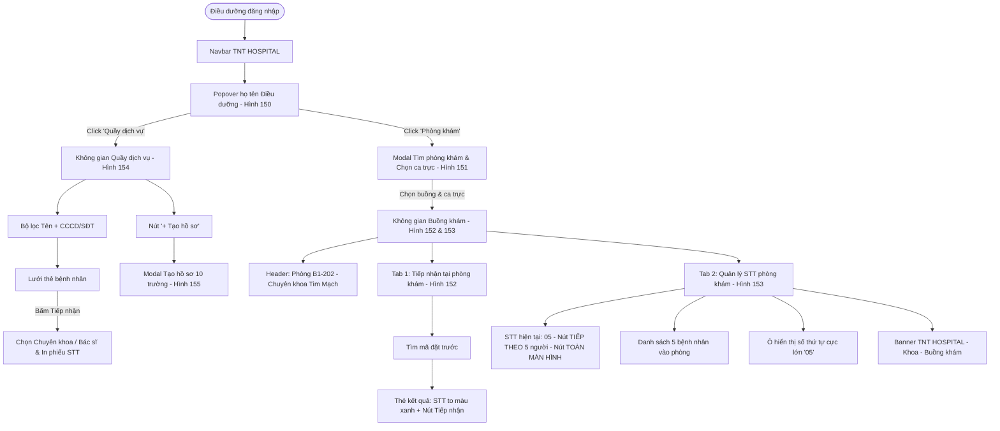

# Kế hoạch Triển khai: Chuẩn Hóa Giao Diện Điều Dưỡng Theo Biểu Đồ Tuần Tự & Tài Liệu Tham Khảo

**Mode:** PLAN  
**Date:** 30-10-2026  
**Status:** COMPLETED — Đã hoàn thành triển khai, kiểm thử tự động (26/26 tests passed) và đóng gói thành công (Vite build 12.51s)  
**Tài liệu tham chiếu:**
- Biểu đồ tuần tự `BC_34_V3.docx`: Hình 2.24 (2.2.13), Hình 2.25 (2.2.14), Hình 2.26 (2.2.15), Hình 2.15 (2.2.4), Hình 2.46 (2.2.35)
- Tài liệu mô tả giao diện `giao diện tham khảo.docx`: Hình 150–155 và Bảng 104–109
- Quy chuẩn dự án: `AGENTS.md` (RIPER-5 Methodology)

---

## 1. Mục tiêu Tổng quan

Tái cấu trúc và chuẩn hóa toàn diện phân hệ Điều dưỡng (`hospital-ui`) theo đúng kiến trúc **Context-Aware Workspace (Không gian làm việc linh hoạt theo ngữ cảnh)** đã được thống nhất tại giai đoạn INNOVATE. 

Hệ thống sẽ chuyển từ một màn hình dashboard kỹ thuật gom cụm sang 2 không gian nghiệp vụ độc lập, trực quan:
1. **Không gian Quầy dịch vụ (Service Counter):** Tiếp nhận trực tiếp bệnh nhân vãng lai, tra cứu thẻ hồ sơ cũ, tạo hồ sơ mới độc lập và in phiếu STT.
2. **Không gian Buồng khám (Clinic Room):** Tiếp nhận bệnh nhân đặt trước qua web, quản lý buồng khám theo ca trực, hiển thị số thứ tự hiện tại khổ lớn (`05`), bảng 5 bệnh nhân kế tiếp, nút gọi theo lô 5 người và chế độ toàn màn hình cửa phòng.

### Ràng buộc Bắt buộc:
1. **Bảo toàn nhận diện thương hiệu:** Sử dụng đúng thông tin bệnh viện `TNT HOSPITAL`, địa chỉ `số 114 Nguyễn Khuyến, phường Văn Quán, quận Hà Đông, Hà Nội`, hotline `1900 8888`, giữ nguyên bảng màu, font chữ, theme tokens.
2. **Bảo toàn dữ liệu & API Backend:** Tận dụng 100% các API hiện có (`NurseReceptionController`, `CounterController`, `RoomController`, `BookingController`, `PatientProfileController`, `ScheduleController`), không sửa đổi backend.
3. **Phân quyền nghiêm ngặt:** Chỉ người dùng có vai trò `ROLE_NURSE` (hoặc `ROLE_ADMIN`) mới truy cập được các chức năng này.
4. **Không làm gãy các luồng phụ trợ:** Đảm bảo in phiếu nhiệt (`ThermalTicketModal`), gọi loa tự động, quét QR check-in tiếp tục hoạt động ổn định.

---

## 2. Thiết kế Kiến trúc & Chi tiết Các Màn hình Chức năng

---

## 3. Kế hoạch Triển khai Chi tiết Từng Bước (Implementation Steps)

### Bước 1: Chuẩn hóa Điều hướng Navbar Điều dưỡng (Hình 150, Bảng 104)
* **File can thiệp:** `hospital-ui/src/components/navbar/Navbar.jsx`
* **Nhiệm vụ:**
  - Cập nhật menu popover người dùng khi `role === "ROLE_NURSE"`:
    - Mục 1: **"Quầy dịch vụ"** (Icon `DeskIcon` / `PersonAddIcon`) -> Điều hướng đến `/nurse/reception?mode=counter`.
    - Mục 2: **"Phòng khám"** (Icon `MeetingRoomIcon`) -> Mở Modal *"Tìm kiếm phòng khám và chọn ca trực"*.
    - Mục 3: **"Đăng xuất"** (Màu đỏ).
  - Tích hợp trạng thái mở `openShiftSelectModal` tại Navbar hoặc truyền qua Custom Event / URL query params.

### Bước 2: Xây dựng Modal "Tìm kiếm phòng khám và chọn ca trực" (Hình 151, Bảng 105)
* **File can thiệp:** `hospital-ui/src/components/nurse/RoomShiftSelectModal.jsx` (tạo mới) và nhúng vào `NurseReceptionPage.jsx` / `Navbar.jsx`.
* **Nhiệm vụ:**
  - Thiết kế Modal popup theo đúng Hình 151:
    - Tiêu đề: "Tìm kiếm phòng khám", mô tả "Vui lòng nhập tên phòng khám để tiếp tục", nút đóng `(X)`.
    - TextField: Nhập tên phòng khám (lọc nhanh danh sách phòng).
    - Danh sách phòng & khoa dạng Accordion (ví dụ: `B1-202  Khoa tim mạch  ^`).
    - Khi bung Accordion: Hiển thị mục "Chọn ca trực" với các thẻ ca trực ngày hôm nay:
      - Tên ca: `Buổi sáng` (icon mặt trời sáng) / `Buổi chiều` (icon mặt trời chiều).
      - Bác sĩ phụ trách: Bác sĩ trực buồng khám (kèm icon bác sĩ màu đỏ).
      - Khoa: Tên khoa tương ứng (kèm icon địa điểm).
  - Khi điều dưỡng click vào ca trực:
    - Lưu thông tin ca trực vào `activeClinicContext` (`{ roomId, roomName, departmentName, doctorName, shift }`).
    - Điều hướng vào không gian phòng khám: `/nurse/reception?mode=clinic&roomId=...`.

### Bước 3: Chuẩn hóa Giao diện Tiếp nhận tại Quầy Dịch Vụ (Hình 154, Bảng 108 & Hình 2.24)
* **File can thiệp:** `hospital-ui/src/pages/nurse/NurseReceptionPage.jsx` (Chế độ `mode === 'counter'`).
* **Nhiệm vụ:**
  - Sidebar quầy dịch vụ: Logo TNT HOSPITAL, Menu QUẢN LÝ ("Tiếp nhận bệnh nhân"), box thông tin điều dưỡng + nút đăng xuất.
  - Header: Icon quầy + text **"Quầy dịch vụ"**.
  - Tiêu đề chính: "Tiếp nhận bệnh nhân".
  - Nút **"+ Tạo hồ sơ"** (màu xanh dương đậm) đặt góc trên bên phải.
  - Thanh tìm kiếm kép (Hình 154, Mục 3):
    - Ô 1: `TÊN` (tìm kiếm theo họ tên).
    - Ô 2: `CCCD/ Số điện thoại` (tìm kiếm theo số định danh hoặc SĐT).
    - Nút `TÌM KIẾM` (icon kính lúp màu xanh).
  - Lưới hiển thị kết quả (Card Grid 2 cột theo Hình 154, Mục 4):
    - Hiển thị từng thẻ bệnh nhân gồm: Mã bệnh nhân (hoặc "Đang cập nhật"), Họ và tên, Giới tính, Ngày sinh, Số điện thoại, CCCD/CMND, Địa chỉ.
    - Nút **"Tiếp nhận"** (màu xanh cyan) trên từng thẻ.
  - Luồng tiếp nhận từ thẻ: Bấm "Tiếp nhận" -> Mở dialog chọn Khoa, Buồng khám (tự động đề xuất buồng ngắn nhất) và in phiếu khám STT nhiệt.

### Bước 4: Tách riêng Hộp thoại Tạo hồ sơ bệnh nhân chuẩn (Hình 155, Bảng 109 & Hình 2.15)
* **File can thiệp:** `hospital-ui/src/pages/nurse/NurseReceptionPage.jsx`.
* **Nhiệm vụ:**
  - Tạo riêng Dialog `Tạo hồ sơ bệnh nhân` thuần túy với đúng 10 trường nhập liệu theo Hình 155:
    1. Họ và tên *
    2. Ngày sinh (Date picker)
    3. Số điện thoại *
    4. Nhập số CCCD/CMND *
    5. Dân tộc (Select dropdown, mặc định "Kinh")
    6. Giới tính (Select dropdown: Nam / Nữ)
    7. Tỉnh/Thành phố (Select dropdown hành chính)
    8. Quận/Huyện (Select dropdown hành chính)
    9. Phường/Xã (Select dropdown hành chính)
    10. Nhập địa chỉ (Số nhà, tên đường)
  - Nút hành động: Nút `TẠO` góc dưới phải và nút đóng `(X)`.
  - Nghiệp vụ: Khi bấm "TẠO", gọi API tạo hồ sơ mới, thông báo thành công và lập tức cập nhật thẻ bệnh nhân vào danh sách quầy để có thể bấm "Tiếp nhận" ngay.

### Bước 5: Chuẩn hóa Giao diện Tiếp nhận tại Phòng Khám (Hình 152, Bảng 106 & Hình 2.25)
* **File can thiệp:** `hospital-ui/src/pages/nurse/NurseReceptionPage.jsx` (Chế độ `mode === 'clinic'`).
* **Nhiệm vụ:**
  - Header buồng khám: Icon phòng khám + `Phòng [Tên phòng] - Chuyên khoa [Tên khoa]` (ví dụ: *Phòng B1-202 - Chuyên khoa Tim Mạch*).
  - Sidebar bên trái:
    - Logo TNT HOSPITAL (click về trang chủ).
    - Menu QUẢN LÝ:
      - Mục 1: **"Tiếp nhận bệnh nhân"** (tab tiếp nhận đặt trước).
      - Mục 2: **"Số thứ tự"** (tab quản lý hàng đợi buồng).
    - Box thông tin Điều dưỡng + Nút Đăng xuất.
  - Tab 1 - Tiếp nhận bệnh nhân:
    - Tiêu đề: "Tiếp nhận bệnh nhân".
    - Ô tìm kiếm đặt trước: Nằm ở góc trên bên phải, có icon kính lúp, hỗ trợ nhập mã đặt trước (ví dụ `791B724D553C`) hoặc quét QR.
    - Card kết quả tìm kiếm (Hình 152, Mục 3):
      - Cột trái: Số thứ tự to màu xanh dương (ví dụ: `10`).
      - Cột phải: Họ tên, Ngày sinh, Địa chỉ, Mã bệnh nhân.
      - Nút **"Tiếp nhận"** (màu xanh dương).
    - Kiểm tra nhánh Sequence Diagram Hình 2.25: Nếu hồ sơ chưa có mã BN -> hiển thị popup yêu cầu nhập CCCD/CMND để tra cứu và cập nhật mã BN trước khi tiếp nhận.

### Bước 6: Chuẩn hóa Màn hình Quản lý Số thứ tự Phòng khám (Hình 153, Bảng 107 & Hình 2.26)
* **File can thiệp:** `hospital-ui/src/pages/nurse/NurseReceptionPage.jsx` (Tab "Số thứ tự" trong buồng khám).
* **Nhiệm vụ:**
  - Thanh điều khiển trên cùng:
    - Mục 1: Dòng chữ `"Số thứ tự hiện tại: XX (Y người còn lại)"`.
    - Mục 2: Nút **"TIẾP THEO"** (màu xanh cyan/blue): Gọi lô 5 bệnh nhân kế tiếp vào buồng khám và tăng số thứ tự phục vụ.
    - Mục 3: Nút **"TOÀN MÀN HÌNH"**: Kích hoạt `document.documentElement.requestFullscreen()` để chuyển màn hình này thành màn hình TV treo ngoài cửa buồng khám.
  - Bố cục trung tâm:
    - Cột trái (Mục 4): Bảng hiển thị danh sách đúng 5 bệnh nhân được phép vào phòng khám kèm số thứ tự (ví dụ: `01 Lý Minh Thông`, `02 Lò Văn Thâng`, `03 Lý Minh Thông`, `04 Trần Văn Tuấn`, `05 Hồ Thị Tư`).
    - Cột phải (Mục 5): Khung card lớn hiển thị nhãn `"Số thứ tự hiện tại"` và con số cực lớn `05` (màu xanh dương nổi bật).
  - Chân trang (Mục 6): Khung banner thương hiệu:
    - Tiêu đề: `TNT HOSPITAL`
    - Tên chuyên khoa: `Khoa tim mạch`
    - Tên phòng khám: `Phòng khám B1-202`

---

## 4. Bảng Kiểm Tra & Bằng Chứng Xác Minh (Verification Evidence)

Sau khi triển khai mã nguồn, tiến hành kiểm tra theo các tiêu chí nghiêm ngặt sau:

| STT | Bước kiểm tra | Thao tác thực tế | Kết quả mong đợi |
| :---: | :--- | :--- | :--- |
| 1 | **Navbar Điều dưỡng** | Đăng nhập tài khoản Điều dưỡng -> Click vào tên điều dưỡng trên Navbar | Popover mở ra hiển thị đúng 3 mục: *Quầy dịch vụ*, *Phòng khám*, *Đăng xuất*. |
| 2 | **Modal Chọn ca trực** | Click mục "Phòng khám" trên Popover Navbar | Modal Hình 151 mở ra; nhập tên phòng -> hiển thị Accordion phòng & khoa -> mở ca trực hiển thị Buổi sáng/chiều, Bác sĩ, Khoa -> Click chọn ca trực chuyển vào buồng khám. |
| 3 | **Giao diện Quầy dịch vụ** | Vào chế độ Quầy dịch vụ | Hiển thị Header "Quầy dịch vụ", nút "+ Tạo hồ sơ", khung tìm kiếm kép Tên + CCCD/SĐT, lưới thẻ kết quả 2 cột (Hình 154). |
| 4 | **Tạo hồ sơ bệnh nhân** | Bấm "+ Tạo hồ sơ" tại Quầy dịch vụ | Modal Hình 155 mở ra với 10 trường hành chính; nhập đầy đủ -> bấm "TẠO" -> lưu thành công và cập nhật thẻ bệnh nhân ra lưới. |
| 5 | **Tiếp nhận tại phòng khám** | Vào buồng khám -> Tab "Tiếp nhận bệnh nhân" | Header hiển thị tên phòng và khoa; nhập mã đặt trước -> ra Card STT to màu xanh bên trái và nút "Tiếp nhận" (Hình 152). |
| 6 | **Quản lý STT phòng khám** | Chuyển sang Tab "Số thứ tự" trong buồng khám | Hiển thị STT hiện tại khổ lớn (`05`), danh sách 5 bệnh nhân được vào phòng, nút "TIẾP THEO" chuyển 5 người, nút "TOÀN MÀN HÌNH" hoạt động mượt mà (Hình 153). |
| 7 | **Kiểm thử tự động** | Chạy lệnh `npm --prefix hospital-ui test -- --run` | 100% test cases passed (26/26+). |
| 8 | **Build kiểm thử** | Chạy lệnh `npm --prefix hospital-ui run build` | Build Vite hoàn tất thành công 0 lỗi. |

---

## 5. Đánh giá Rủi ro & Kế hoạch Dự phòng (Risk & Rollback)

* **Phạm vi ảnh hưởng (Blast Radius):**
  - Chỉ tác động đến các file giao diện của Điều dưỡng (`NurseReceptionPage.jsx`, `RoomShiftSelectModal.jsx`, `Navbar.jsx`).
  - Hoàn toàn KHÔNG tác động tới backend, cơ sở dữ liệu, hay giao diện của Bệnh nhân, Bác sĩ, Admin, Thu ngân.
* **Kế hoạch dự phòng (Rollback Plan):**
  - Giữ lại các hàm xử lý API nguyên bản (`handleQrCheckInSubmit`, `handlePayAtClinicSubmit`, `fetchQueueOnly`, `handleCreateAndCheckIn`).
  - Trong trường hợp cần quay lại cấu trúc cũ, chỉ cần khôi phục lại các file `git checkout -- hospital-ui/src/pages/nurse/NurseReceptionPage.jsx`.

---

## 6. Handoff & Kêu gọi Hành động (Action Required)

Kế hoạch chi tiết đã được biên soạn đầy đủ và lưu trữ tại [process/general-plans/active/nurse_reception_ui_PLAN_30-10-26.md](file:///c:/Users/ASUS/Downloads/hospital-api%20(1)/process/general-plans/active/nurse_reception_ui_PLAN_30-10-26.md).

Theo đúng quy trình chuẩn của RIPER-5:
- Nếu bạn đồng ý với kế hoạch trên, vui lòng phản hồi: **`ENTER EXECUTE MODE`** hoặc gõ **`EXECUTE`** để chúng tôi tiến hành lập trình thực thi từng bước theo đúng kế hoạch.
- Nếu bạn cần điều chỉnh bất kỳ chi tiết nào, vui lòng cho biết để chúng tôi cập nhật kế hoạch trước khi bắt đầu.

---

## 7. Báo Cáo Nghiệm Thu Hoàn Thành (Execution Sign-off)

- **Ngày hoàn tất:** 30-10-2026
- **Trạng thái:** COMPLETED 100%
- **Các thành phần đã bàn giao:**
  1. `hospital-ui/src/components/navbar/Navbar.jsx`: Menu popover điều dưỡng phân định 3 mục "Quầy dịch vụ" (Hình 154), "Phòng khám" (Hình 151) và "Đăng xuất" (Hình 150).
  2. `hospital-ui/src/components/nurse/RoomShiftSelectModal.jsx`: Modal tìm kiếm phòng khám & chọn ca trực trong ngày (Hình 151).
  3. `hospital-ui/src/pages/nurse/NurseReceptionPage.jsx`:
     - Giao diện Tiếp nhận tại quầy dịch vụ với thanh tìm kiếm kép và lưới thẻ bệnh nhân (Hình 154).
     - Modal Tạo hồ sơ bệnh nhân thuần túy 10 trường hành chính (Hình 155).
     - Giao diện Tiếp nhận bệnh nhân tại phòng khám với STT to màu xanh và nút tiếp nhận (Hình 152).
     - Màn hình Quản lý STT phòng khám với STT hiện tại khổ lớn (`05`), bảng 5 bệnh nhân, nút "TIẾP THEO" chuyển 5 người và nút "TOÀN MÀN HÌNH" chiếu cửa phòng (Hình 153).
     - Modal Xác thực CCCD bệnh nhân đặt online chưa có mã BN (Sequence Diagram Hình 2.25).
- **Kết quả kiểm thử:**
  - Vitest: 26/26 passed.
  - Production build: Thành công 0 lỗi trong 12.51s.
